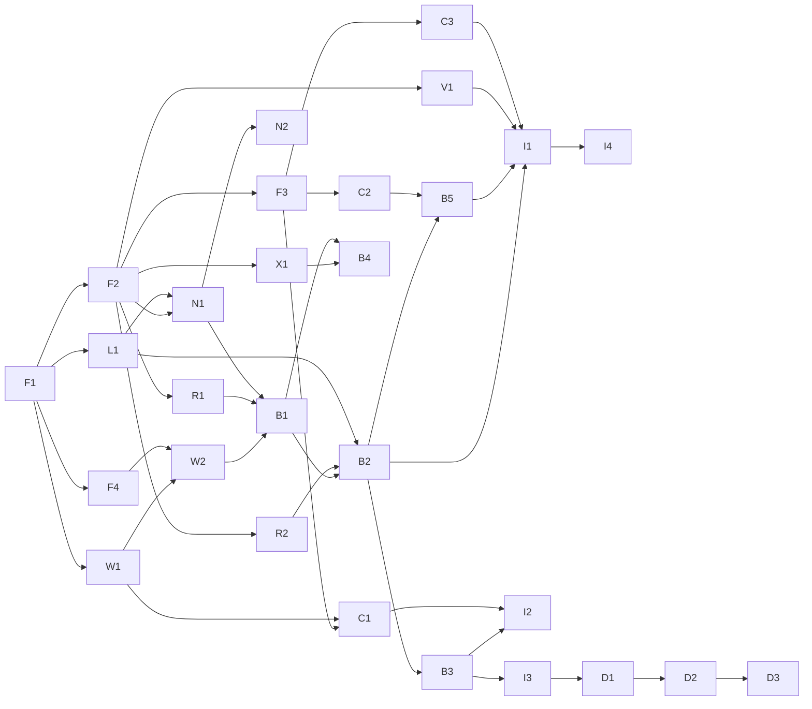

# Simile POC plan

Goal: a playable slice of the village described in the [README](../README.md). The player can walk around a small town with about 10 NPCs who move about, read the news, talk to each other and to the player in their own voices, and form relationships that change over time.

## Architecture

```
┌──────────────┐  WebSocket (JSON + audio chunks)  ┌──────────────────────────────────┐
│ Client       │ ◀───────────────────────────────▶ │ Sim server (Python)              │
│ render, input│                                   │  world clock + tick loop         │
│ dialogue UI  │                                   │  NPC behaviour / pathfinding     │
│ spatial audio│                                   │  conversation engine ──▶ LLM     │
└──────────────┘                                   │  relationships + memory (SQLite) │
                                                   │  news ingest                     │
                                                   │  TTS worker (MLX, from voice-lab)│
                                                   └──────────────────────────────────┘
```

- **The server is authoritative.** The whole simulation runs headless, so it can be tested and run fast-forward without the client. The client is a view: it renders state, sends player input, and plays audio.
- **Python on the server** because the TTS is already Python/MLX and the LLM SDKs are first-class there.
- **Contracts first.** The data schemas and the client↔server protocol are fixed before the parallel work starts, so subagents can build against them without talking to each other.

## Decisions

| Decision | Choice | Why |
|---|---|---|
| Client engine | **Phaser 3 + TypeScript** in the browser (Vite) | Loads Tiled maps directly, Web Audio's `PannerNode` gives distance/pan audio for free, fast reload loop. Godot would be the stronger choice if this grows past a POC. |
| LLM | **Claude API** behind a pluggable interface | A local LLM would compete with TTS for the same GPU. Use a small model (Haiku) for NPC↔NPC chatter and summarisation; cap concurrent conversations to bound cost. |
| Art | **CC0 placeholder packs** (Kenney etc.) | Swap later; nothing depends on it. |

## Phases

Tasks inside a phase can run in parallel unless they list a dependency. IDs are stable so tasks can reference each other.

### Phase 0: Foundations (sequential, one agent)

| ID | Task | Done when |
|---|---|---|
| F1 | Repo layout and tooling: `server/` (uv, pytest, ruff), `client/` (Vite + Phaser + TS), `content/` (generated NPCs, map), CI running both test suites | `make test` passes on an empty skeleton in CI |
| F2 | Domain schemas (pydantic, exported as JSON Schema): `Npc` (values, persona, voice), `Relationship`, `InteractionEvent`, `Flag`, `Memory`, `NewsItem`, `Location`, `Conversation`, `Line` | Schemas merged with example fixtures |
| F3 | Client↔server protocol: snapshot, entity moved, conversation started/ended, line (text + duration), audio chunk, player move, player say | Protocol doc + TS types generated from the schemas |
| F4 | Sim clock and tick loop, headless runner with a `--speed` multiplier | A no-op world ticks at 1x and 10x in tests |

### Phase 1: Independent tracks (parallel)

Each track owns its own directory, so agents can't collide.

| ID | Track | Task | Depends on |
|---|---|---|---|
| W1 | World | Town map in Tiled: houses for each NPC, coffee shop, town square, news terminals, 2–3 more amenities; walkable/blocked layer; named location markers | F1 |
| W2 | World | Grid pathfinding (A*) and movement on the server, using W1's collision layer | F4, W1 |
| C1 | Client | Render map, player movement, NPC sprites from server snapshots/deltas, camera follow | F3, W1 |
| C2 | Client | Dialogue UI: speech bubbles for nearby lines, chat box for the player, conversation log | F3 |
| C3 | Client | Streamed audio playback positioned at the speaker, volume/pan by distance | F3 |
| N1 | NPCs | NPC generator: 10 NPCs with value scores, name, age, job, home, persona, voice description, neutral reference line. Values must visibly drive persona and voice | F2, L1 |
| N2 | NPCs | Batch voice design: a reference clip per generated NPC (from `voice-lab/design_then_clone.py`) | N1 |
| R1 | Social | Relationship model: like/trust/respect/familiarity, familiarity dampening, 2–3× negativity bias, decay toward a personality baseline, persistent flags (debts, grudges, broken promises). Pure functions, heavily unit-tested | F2 |
| R2 | Social | Memory store: per-pair event log, conversation summaries, retrieval ranked by recency × salience, in SQLite | F2 |
| L1 | LLM | LLM client: streaming, provider-pluggable, prompt templates, structured-output helper, token/latency/cost logging, a fake provider for tests | F1 |
| V1 | Voice | TTS service from `clone_mlx.py`: load model once, cache each NPC's processed reference, sentence in → streamed audio chunks out, priority queue with a concurrency cap | F2 |
| X1 | News | RSS ingest of the Big Think feed, dedupe, store as `NewsItem`s, refresh on an interval | F2 |

### Phase 2: Agent behaviour

| ID | Task | Depends on |
|---|---|---|
| B1 | NPC decision loop (utility AI): choose between going home, coffee shop, square, terminal, wandering, or seeking someone out, weighted by values, relationships and time of day | W2, R1, N1 |
| B2 | NPC↔NPC conversation engine: approach/accept/decline, turn-taking, prompt assembly (both personas, relationship, shared history, recent news, topics they care about), engagement score that decides when someone leaves, real-time pacing from word count, one line generated ahead | B1, R2, L1 |
| B3 | Post-conversation processing: the LLM extracts `InteractionEvent`s and flags, which update relationships and memories | B2, R1, R2 |
| B4 | News behaviour: an NPC at a terminal reads articles, rates each against their values (valence × intensity), stores it as a memory, and is more likely to raise strong, recent ones in conversation | X1, B1, R2, L1 |
| B5 | Player↔NPC conversation: low-latency streaming path, NPCs may start a conversation with the player, the player is a full relationship participant | B2, C2 |

### Phase 3: Integration

| ID | Task | Depends on |
|---|---|---|
| I1 | Earshot voicing: split the LLM stream into sentences, send to V1 only for conversations within earshot, start/stop as the player moves | B2, B5, V1, C3 |
| I2 | Debug overlay: per-NPC current goal, top values, relationship table, recent memories, live conversation transcripts. Essential for tuning a simulation | B3, C1 |
| I3 | Save/load world state (relationships, memories, flags, positions, clock) | B3 |
| I4 | Performance pass: latency budget for player replies, concurrent conversation cap, LLM spend per sim-hour | I1 |

### Phase 4: Tuning and demo

| ID | Task | Depends on |
|---|---|---|
| D1 | Headless soak test: run the village at 10x for a sim-day, report relationship drift, conversation counts, repeated topics, cost | I3 |
| D2 | Tuning pass on values → behaviour weights and relationship constants, using D1's report | D1 |
| D3 | Scripted demo scenario (e.g. a news story that splits the village) and a short recording | D2, I1 |

## Dependency graph



The critical path is F1 → F2 → R1/N1 → B1 → B2 → B5 → I1. The client, voice and news tracks have slack and can absorb extra agents.

## Tracking and assigning tasks

Each task above becomes one issue (GitHub Issues or Linear) and one PR. An issue carries:

- **ID and title**, e.g. `R1: Relationship model`.
- **Depends on**: the IDs above. An issue is ready when all of them are merged.
- **Owns**: the paths the agent may change (e.g. `server/simile/social/`). Two tasks in flight never own the same paths. Shared contracts (`server/simile/schema/`, the protocol) change only through their own small PR.
- **Contract**: the schemas and protocol messages it must use or produce, linked rather than restated.
- **Done when**: a concrete check, either tests that must pass or a command that demonstrates it (`uv run simile headless --speed 10` shows NPCs walking to the coffee shop).
- **Labels**: `phase-N` and a track (`world`, `client`, `npc`, `social`, `llm`, `voice`, `news`, `behaviour`, `integration`).

Dispatching: a lead session picks every ready issue, starts one subagent per issue in its own worktree branched from `origin/main`, and merges PRs as they go green. Merging unblocks the next set. With the plan above that's roughly 1 agent in Phase 0, up to 12 in parallel in Phase 1, then 2–4 at a time from Phase 2 on, where the work converges on the conversation engine.
