# Residents study: whole, cut, 3D and repainted (#334)

The user found the game's residents much worse than the villagers of #295's first style study,
which FLUX painted whole. #310 builds each resident in code: seven flat pieces drawn from their
`Appearance`, which FLUX only textures, scaled to about 80 px and turned at the joints. This study
tries four other ways on the same four residents, walking side-on, and puts them beside today's
dolls:

1. **Whole FLUX characters,** flat like Paper Mario's: painted whole, with a few painted poses the
   client swaps, flips and bobs.
2. **Painted whole, then cut:** a mannequin of the rig guides FLUX, which redraws the resident
   freely; the painting is then cut into #310's pieces for the client's rig.
3. **3D models in Blender,** built with MPFB from CC0 MakeHuman assets, toon-shaded and posed by
   the rig's own joint angles.
4. **3's renders repainted by FLUX** in edit mode, frame by frame.

Nothing here changes the game. It stops at a recommendation, and **the user decides.**

**Contents:** [the residents and the style](#the-residents-and-the-style) ·
[side by side](#side-by-side) · [each approach](#each-approach) ·
[the questions](#the-questions) · [recommendation](#recommendation) ·
[taste calls](#taste-calls-for-the-user) · [what wasn't tested](#what-wasnt-tested) ·
[assets and licences](#assets-and-licences) · [files](#files)

## The residents and the style

| | Build | Skin | Hair | Wears |
|---|---|---|---|---|
| Lachlan | broad | pale | silver, buzzed | a cap |
| Odalys | average | golden tan | curly, dark brown | an apron |
| Ingrid | slim | light brown | dark brown ponytail | a backpack |
| Henrietta | average | deep brown | grey bun | a scarf |

**The style is #329's recommendation, the revised Klei-like cartoon (`grimy`):** heads 1.6 times
#310's, one scratchy drawn outline, and grime kept light on faces, since the reviewer found it
heavy at 1.8 times. Every approach is judged against #329's grimy street and dollhouse, drawn by
#329's own code at 80 px/m, as a retina screen draws them:

- **Today's dolls** are #329's grimy dolls: #310's pipeline with #329's prompt, the drawn outline,
  heads 1.6 times.
- **The FLUX approaches** ask for #329's grimy look with "a few light smudges on the clothes" and
  "the face clean". Approaches 2 and 4, and 1b, paint in edit mode with #329's grimy residents
  reference as the style image, as #310 does. Approach 1 paints from text alone, as #295's
  villagers were.
- **The 3D models** take #329's proportions from bone scales (the head grown 1.9 times and the
  legs shortened, so the head is about as big a share of the height as #329's dolls'), a
  two-tone toon shader, Freestyle lines in #329's ink colour with a scratchy width, and a grime
  texture FLUX painted.

FLUX.2 Klein 4B runs through mflux at 8 bits, as #329 recommends. No approach makes an LLM call.

## Side by side

The four residents standing, at full size, about 420 px tall:

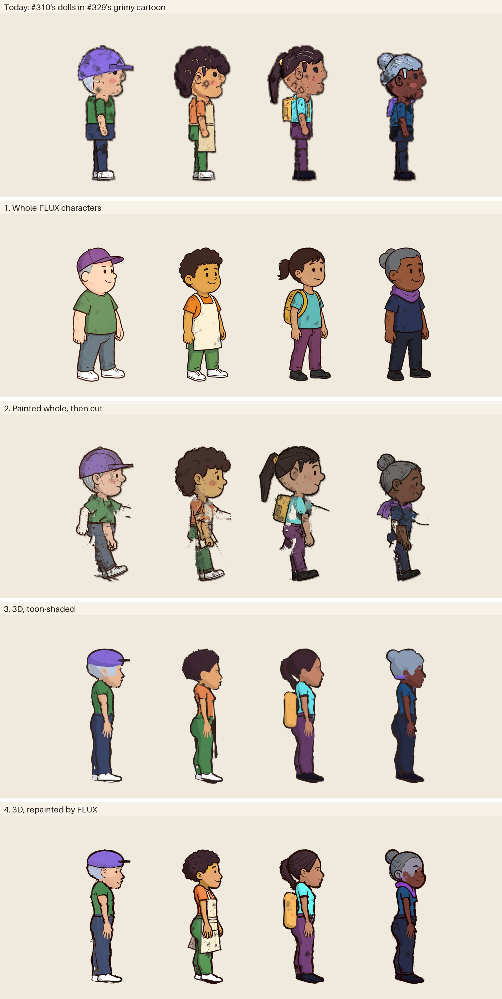

At play size, 1:1: about 82 px tall as a 1× screen draws them at 40 px/m (left), and 163 px as a
retina screen draws them at 80 px/m (right). Open it at 100% to judge:

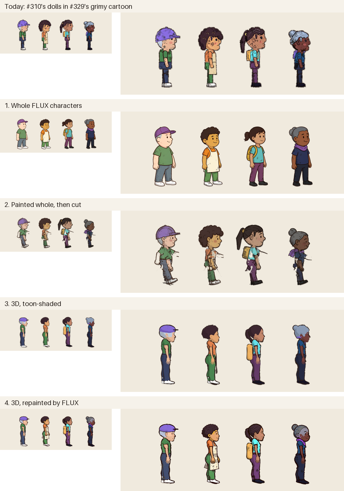

Walking, eight frames at 135 ms each, with approach 1b (below) last:

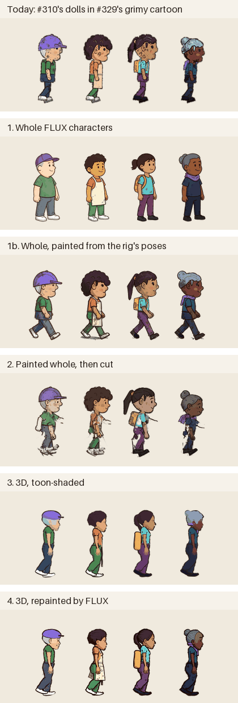

On #329's grimy High Street at 80 px/m, the coffee shop's square, as a retina screen draws it:

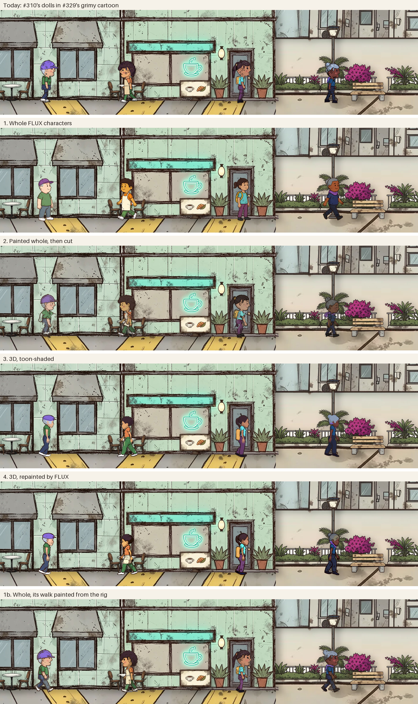

At play size on the street, 1:1 at 40 px/m and 80 px/m, as #329 compared its styles:

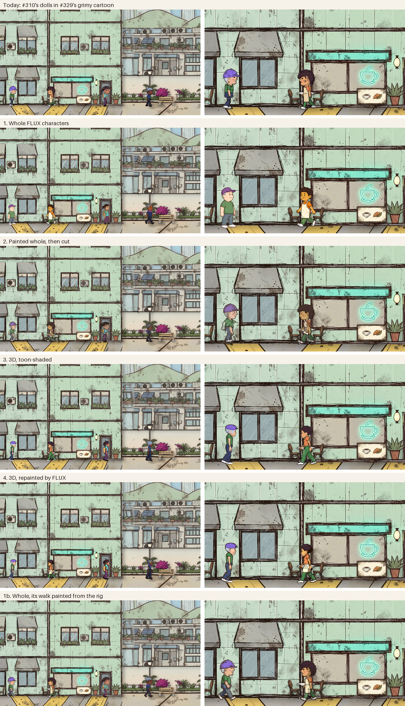

In #329's coffee shop at 60 px/m:

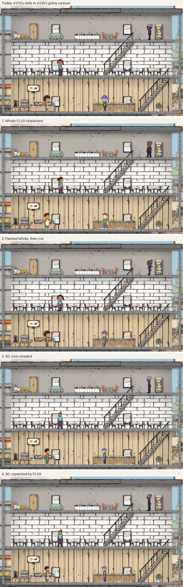

## Each approach

Each approach's residents standing, walking (four of its eight frames), sitting, climbing stairs,
climbing a ladder seen from behind, and from the front and the back, at about twice their size on
a retina screen. Then its walk, and its residents on #329's grimy street at 80 px/m.

### Today: #310's dolls in #329's grimy cartoon

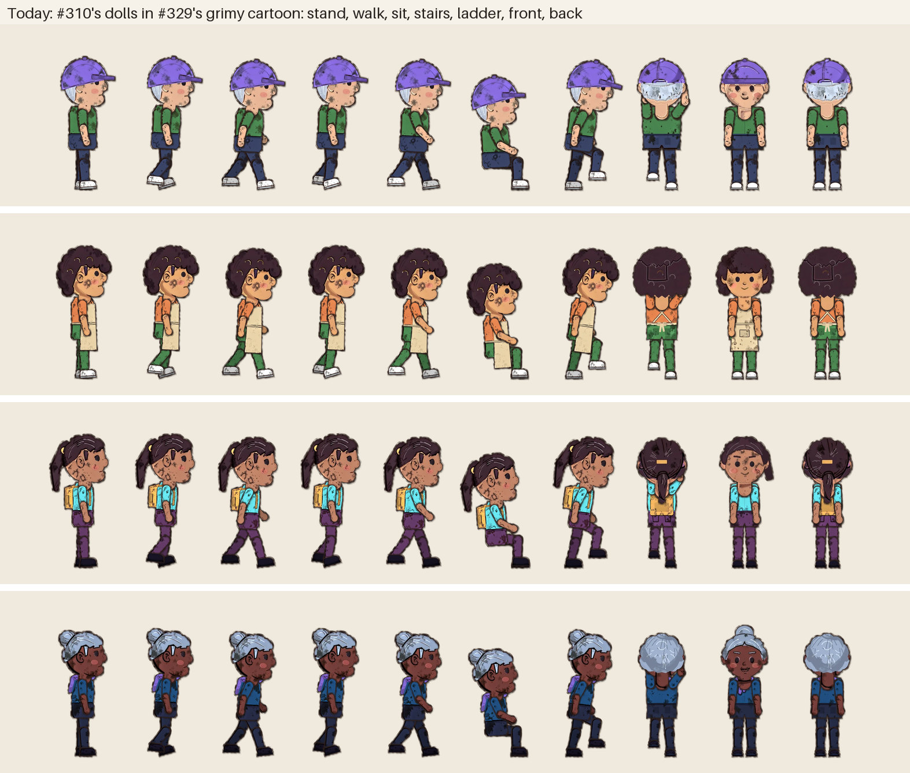

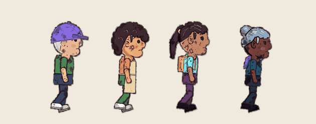


#329's grimy dolls, as its study made them: #310's seven flat pieces per view, painted by FLUX
with the grimy prompt and no outline, colour-restored, then drawn by a Python port of the client's
rig with heads 1.6 times, the neck sunk, the shoulders dropped and a scratchy outline drawn round
every piece. Every pose is a set of joint angles, so sitting, stairs and ladders need no new art.
The shapes are code's: FLUX only textures them, and it puts grime on the faces too.

### 1. Whole FLUX characters

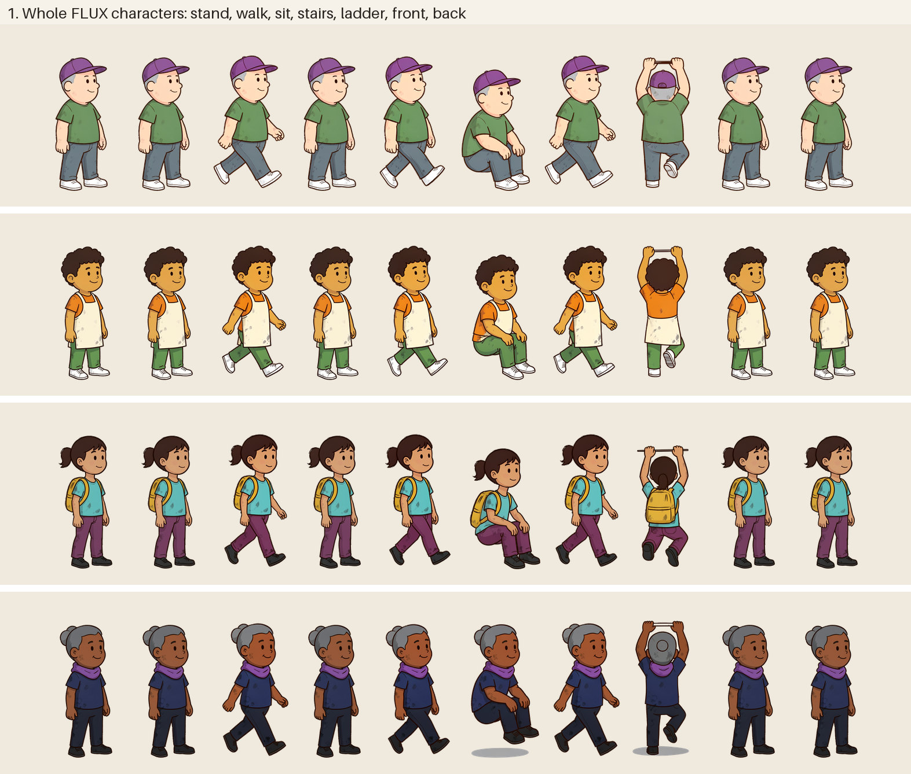

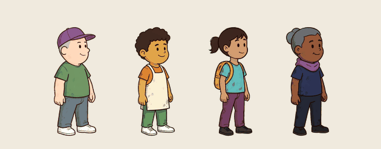


Each resident is painted from text alone, as #295's villagers were: one full-body figure in
three-quarter view facing right, on light grey, with #310's words for their skin, hair and
accessories, their clothes' colours and build, the grimy look, "a very big round head, almost half
their height" and "the face clean" (`whole.py`). Every other pose is an edit of that painting in
edit mode: "the same character, unchanged in every detail", now mid-stride, sitting, or seen from
behind climbing. Each is cut out with #309's IS-Net and key, and stands under the middle of its
head, so the head doesn't jump as the legs change.

- **The walk is the standing painting and a stride,** swapped every other frame, with a bob and a
  2.5° sway, and flipped to walk west. A second edit asked for the passing pose, "standing on the
  straight right leg with the left knee lifted", and FLUX drew the same stride again for all four,
  so the walk has two leg drawings, not four.
- **Sitting and climbing are one painting each,** and FLUX kept every resident's face, hair,
  clothes and accessories through every edit. It wouldn't leave out the furniture at first: the
  pilot sat Lachlan on a box and climbed him up a ladder, until the prompt said "in mid-air with
  nothing under them: no chair, no box, no seat" and "no ladder, no steps, no rungs". The climbs
  still grip a short rung. Stairs use the walk, and a ladder flips the climb from side to side.
- **There's no side view, front view or back view** but the climb's: the three-quarter figure
  stands for all of them, as Paper Mario's do.
- **The line is clean, not scratchy.** From text alone, without #329's reference, FLUX drew a
  smooth, even ink line and very little grime: the cleanest of the approaches, and the furthest
  from #329's palette (below).

#### 1b. Its walk painted from the rig

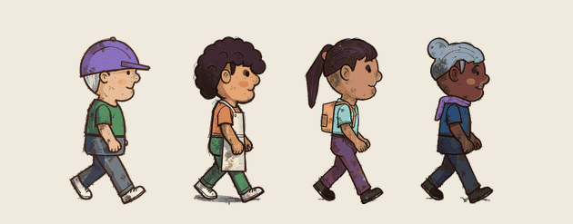

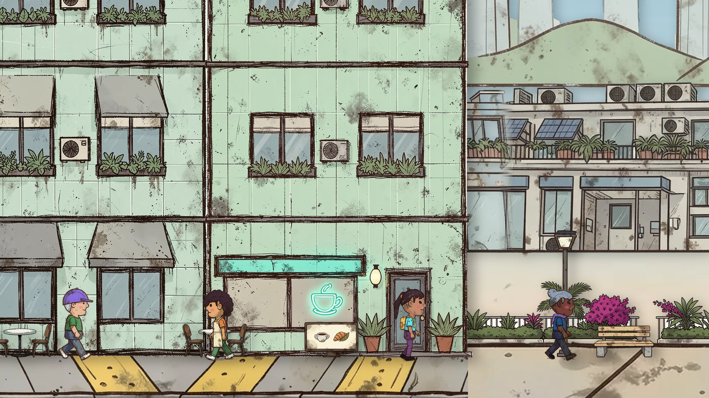

The issue's approaches left a gap between 1 and 2: FLUX paints a whole character beautifully, but
only in the poses it chooses. So 1b lays out the rig's own walk, four frames of the flat doll
side-on at #329's proportions, on one sheet, and FLUX redraws it as one whole person four times,
with the grimy reference, as approach 2 paints its sheet (`whole.py strip`). Nothing is cut into
pieces: each figure is cut out whole and played as a sprite, each held for two of the cycle's
eight frames. Then #310's colour restore pulls each region back to the `Look`, with the fitted
mannequin as the map. Because the map only roughly lines up with a free painting, each region's
correction moves only the pixels painted near its typical colour (`study.restored`).

- **Every resident is the same person in all four frames,** side-on, with the grimy line, the
  smudges and the big head, and their legs really walk: the frames follow the rig's leg angles.
  The arms swing less than the rig's.
- **The restore works:** skin within ΔE 1.6 of the `Look` for all four, against 9.5 before it.
- **The same sheet takes any pose the rig has,** so standing, sitting, a stair step and a ladder
  climb from behind would be one more sheet of four. Only the walk was painted here: standing,
  sitting and climbing in its pictures are approach 1's.

### 2. Painted whole, then cut

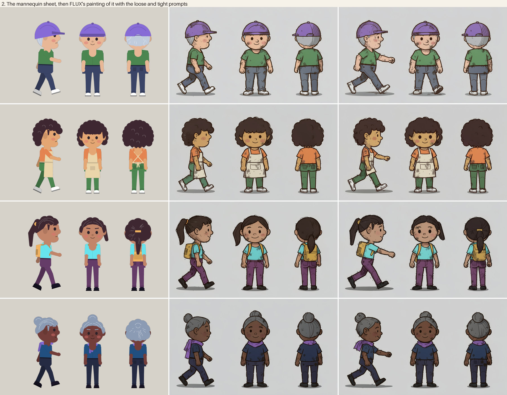

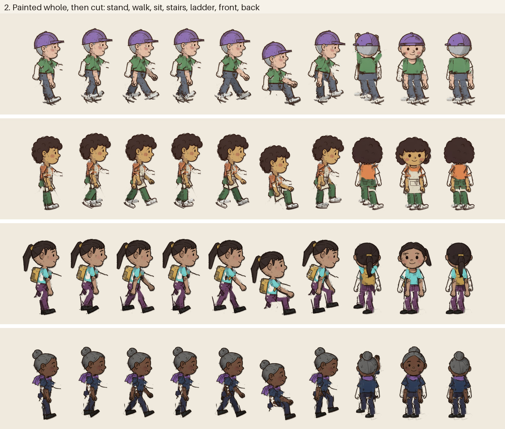

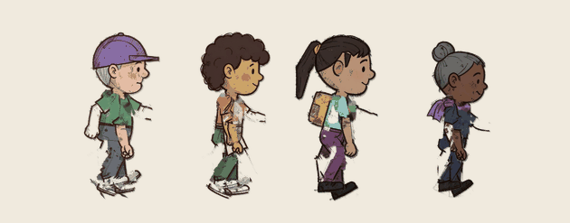


Each resident's flat doll, at #329's grimy proportions, is posed by the rig three times on one
sheet: side-on with the near arm and leg swung clear of the body, from the front, and from behind
(`cut.py`). FLUX redraws the sheet in edit mode with the grimy residents reference, "freely as one
whole person with natural rounded shapes, real clothes, hands and shoes, rather than separate
flat pieces". Then the cut:

1. **Fit:** each painted figure is matched to its mannequin by its box, as FLUX moves and resizes
   them.
2. **Assign:** each painted pixel goes to the mannequin piece nearest it whose colours are nearest
   its own, so a shirt painted where the mannequin's head was still goes to the torso. Ink goes
   to the piece on top.
3. **Unturn:** each near piece is turned back upright into #310's frame, with its pivot and joints.
   The far arm and leg reuse the near ones, as #310's do.
4. **Fill:** what another piece covered, such as the torso under the arm, is inpainted from round
   it.

**The paintings are the study's best-looking residents,** whole, grimy and characterful, closest
of all to #329's palette. **The cut ruins them.** Two prompts were tried:

- **Loose,** as the issue asked: "keep each figure's pose, size and place … but draw it freely".
  FLUX drew every side-on figure 150 to 170 px left of its mannequin (100 to 140 px with the
  tight prompt), which the fit takes out, and dropped the forward-reaching near arm to the side
  in all four. The arm is then painted over the torso, where the cut can't separate it:
  the arm pieces come out as fragments, and the torso carries a painted arm that stays put while
  the rig swings the real one.
- **Tight:** "keep each figure's exact pose, place, size and outline", with the arm and leg
  described. All four kept the forward arm, and the cut finds most of it. The pictures above are
  the tight prompt's.

**The cuts show, at both:**

- **At the hips,** the painted shirt or apron hangs over the thigh, so the thigh piece is 75 to
  100% filled in from round it (`covered.json`). As the leg swings, a smear of trouser shows
  under the shirt.
- **At the shoulders,** the arm pieces carry slivers of the painting's outline and background, and
  the torso a filled-in patch where the painted arm was.
- **Everywhere,** the painted outline belongs to whichever piece it was assigned to, so a piece
  that turns away leaves a line behind, and a cut edge has no line at all.
- **The front and back torsos are 31 to 64% filled in,** under the arms the rig hangs over them.

Cutting needs the painting to match the mannequin's pieces, and FLUX keeps to them only as far as
it's told to keep #310's shapes, which is what the user found wrong with them. Hand-fixing each
atlas would work, but not for a creator.

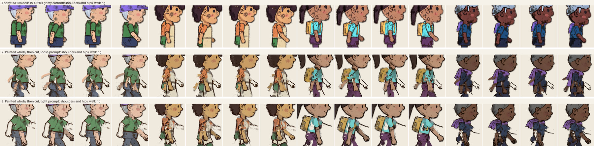

### 3. 3D, toon-shaded

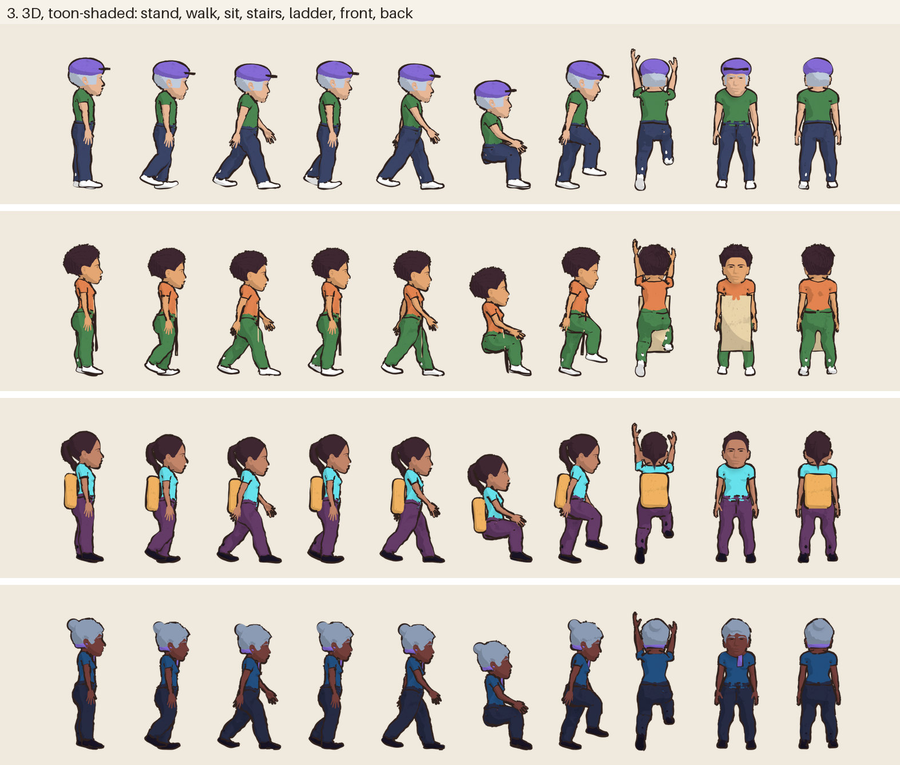

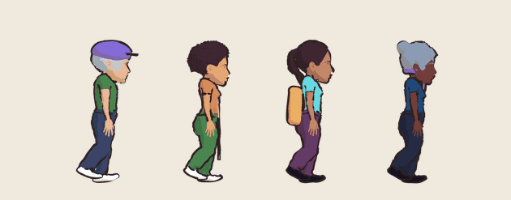


`model.py` turns each `Appearance` into a spec, and `mpfb/build.py` builds it in Blender 5.2.2,
headless, with MPFB:

- **The body:** MPFB's sliders from the build (weight and muscle), and from the resident's record
  their age and, from their voice's description, their gender, which the `Appearance` doesn't
  have.
- **Clothes and hair:** a CC0 t-shirt, trousers, sneakers and hair from MakeHuman's packs, each
  hair style mapped to one hair. The cap, bun, apron, scarf, backpack and headphones are simple
  shapes made in the script.
- **Proportions:** the head grown 1.9 times and the legs, body, neck and arms shortened, bone by
  bone, for #329's big heads.
- **The look:** every material is its `Look` colour in two flat tones, with FLUX's grime texture
  multiplied into the clothes. Freestyle draws the lines: every silhouette and hem of the body and
  clothes, and only the outer edge of the hair, face and hands, in #329's ink with a noisy width.
- **The pose:** the rig's own angles from `rig.ts`, set on MPFB's `game_engine` bones as turns
  about the side-to-side axis: the same walk, sit, stairs and ladder as the dolls.
- **The renders:** orthographic, 300 px/m, 512 × 768, one toon render and one flat render in the
  `Look`'s exact colours per frame, the second for measuring. 20 frames a resident: the walk's
  eight, standing side-on, front and back, sitting, four stair steps and four ladder steps.

### 4. 3D, repainted by FLUX

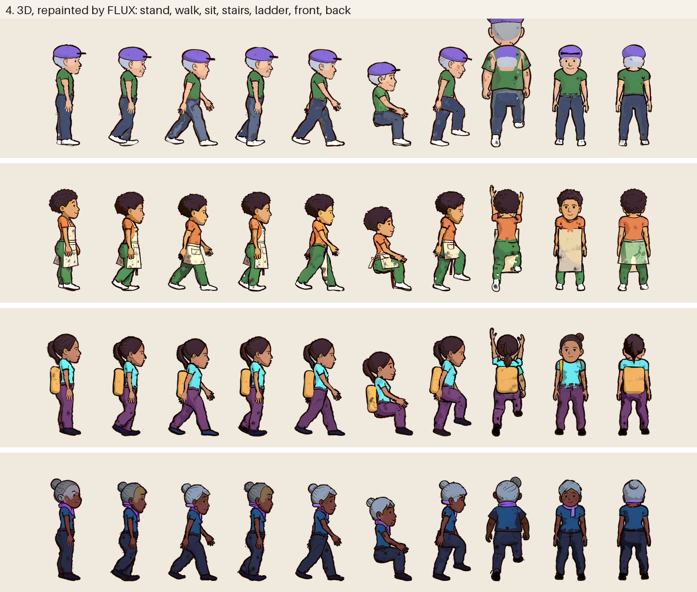

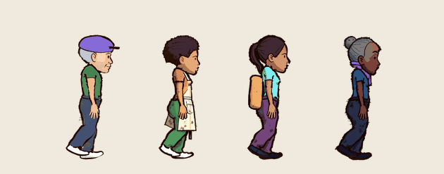


Each of approach 3's frames goes to FLUX on grey, with the grimy residents reference: "the same
cartoon character in exactly the same pose, place and size" in the grimy style, with "the face
clean" (`repaint.py`). Then #310's colour restore pulls each region back to the `Look`, with
Blender's flat pass as the map of regions, which approach 3 gives for free. Two ways:

- **Frame by frame:** each of the 14 frames a resident on its own.
- **Four to a painting:** the walk's eight frames as two strips of four, which FLUX keeps more
  alike.

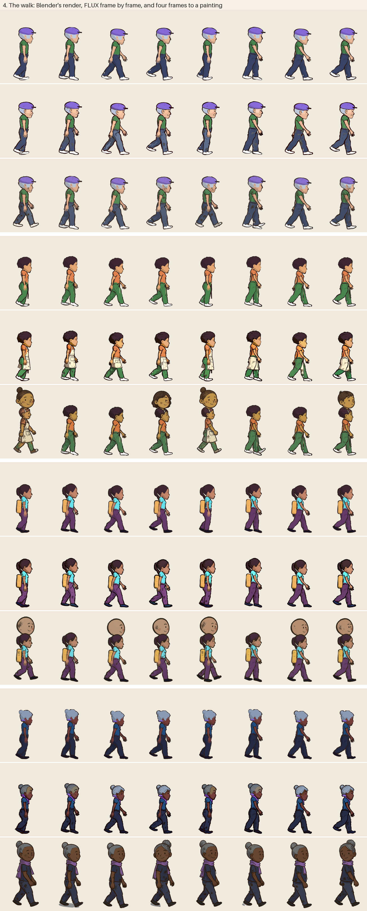

- **Frame by frame, FLUX keeps the pose and the outline:** each repaint covers 91 to 98% the
  same pixels as its render (the overlap of their silhouettes, mean 0.95 to 0.97 per resident).
  The faces become cartoon faces with dot eyes and smiles, and the line and grime become #329's.
- **But each frame is a new drawing.** Faces, hair and the apron's folds change from frame to
  frame, so the walk shimmers (below). One of the 56 frames, Lachlan's ladder climb, FLUX drew at
  twice the size.
- **Four frames to a painting is worse here, not better.** In strips of four 336 px frames, FLUX
  added a big extra head above the figure in four of Odalys's eight frames and six of Ingrid's,
  and redrew Henrietta larger, in three-quarter view, in all eight. Only Lachlan's strips kept to
  the renders. 1b's sheets, four 2D mannequins at the same width, had none of this, so it's the
  3D renders' small, realistic figures that FLUX reads loosely.
- **The restore is needed and works:** skin within ΔE 1.0 of the `Look` after it, against up to
  14 before. With a map that only roughly lines up, #310's own restore tinted Henrietta's face
  where the map had hair; the careful restore 1b uses doesn't.
- **The 3D proportions stay:** FLUX keeps approach 3's long legs and small head, so the heads are
  a quarter of the height, against about a third for the 2D approaches.

## The questions

### Quality against #295's villagers

#295's villagers (`docs/side-view-study/references/characters.jpg`) and #329's grimy residents
reference are whole characters painted in one go: one figure, one line, a face and hands drawn
for the body they're on. The approaches that let FLUX do that come closest:

| | Against #295's villagers |
|---|---|
| Today | A puppet: seven rigid pieces with a line round each, faces grimy, hands as stubs |
| 1. Whole | The same kind of picture as the villagers: whole, clean faces, real hands, folds and shoes. Cleaner than #329's grime, and seen only in three-quarter view |
| 1b. Whole from the rig | As good, and side-on: grimy, scratchy and big-headed like #329's reference, walking |
| 2. Painted, then cut | The paintings are as good as 1b's. Cut and re-posed, they fall apart at every joint |
| 3. 3D | A 3D game's characters: realistic MakeHuman faces and hands under flat shading, thin limbs |
| 4. 3D repainted | Cartoon faces, line and grime over 3D poses, but the 3D proportions and a face that changes every frame |

**Why today's residents look worse** is what the issue found: the shapes are code's, and FLUX only
decorates them. Every approach that gives FLUX the whole body to draw (1, 1b, 2's paintings and
4) looks more like the villagers. The question is how to keep that through a walk.

### Keeping each resident themselves

**Every approach kept every resident recognisable:** skin, hair style, clothes and accessories,
in every pose. Their colours drift unless something pulls them back. Measured as
`dolls.matched` checks a doll: each region of the `Look` (skin, hair, top, bottom, shoes, the
accent and the apron), its median painted colour against its flat one, CIEDE2000, on each
resident standing side-on (`pictures.py match`):

- **By region,** where a picture in the `Look`'s exact colours lines up with the painting: today's
  flat doll, and Blender's flat pass for 3 and 4. Shrunk 2 px, or 5 px for 4's repaints.
- **By nearest cluster,** for every approach, since 1, 1b and 2 have no such picture: the figure's
  colours in 12 clusters, and each region against the nearest cluster covering 0.6% of it. It
  finds whether a colour is there, not where, so it can't fail a region painted in another
  region's colour.

| | Today | 1 | 1b | 1b before restore | 2 | 3 | 4 | 4 before restore |
|---|--:|--:|--:|--:|--:|--:|--:|--:|
| Mean, by nearest cluster | 2.3 | 8.9 | 4.2 | 9.8 | 9.4 | 1.2 | 3.5 | 8.1 |
| Regions over ΔE 6, of 24 | 3 | 19 | 7 | 21 | 19 | 2 | 5 | 16 |
| Skin, worst of four | 0.8 | 8.8 | 1.6 | 9.5 | 9.0 | 0.0 | 1.0 | 10.4 |
| Mean, by region | 1.1 | | | | | 1.4 | 4.6 | 11.8 |

**The worst region in each:**

| | Measured | Region | Wanted | Got | ΔE |
|---|---|---|---|---|--:|
| Today | by region | Henrietta's scarf | `#866bd7` | `#7054b2` | 9.7 |
| 1. Whole | by cluster | Henrietta's hair: grey for blue-grey | `#8b9bb4` | `#6c6d71` | 18.9 |
| 1b. Whole from the rig | by cluster | Odalys's white shoes, cream | `#ffffff` | `#e3dec1` | 13.6 |
| 2. Painted, then cut | by cluster | Henrietta's hair: grey for blue-grey | `#8b9bb4` | `#686765` | 23.0 |
| 3. 3D | by cluster | Odalys's apron, seen edge-on from the side | `#ead4aa` | `#e4a672` | 14.7 |
| 3. 3D | by region | Henrietta's scarf | `#866bd7` | `#725bb8` | 7.6 |
| 4. 3D repainted | by region | Henrietta's scarf: FLUX drew it thinner than the model's, so the map finds ink | `#866bd7` | `#150000` | 46.2 |
| 4. 3D repainted | by cluster | Odalys's white shoes, cream | `#ffffff` | `#faf2d6` | 11.4 |

- **FLUX paints the colour's name, not its value:** "grey hair" comes out neutral grey, "slate blue
  trousers" lighter than the `Look`'s navy, and skin drifts by ΔE 5 to 10. #310 found the same and
  added its restore.
- **The restore needs a map of the regions.** Approach 1 has none, so its colours are FLUX's.
  1b's mannequin and 4's flat pass are maps, and with them the restore brings skin within ΔE 1.6
  and 1.0.
- **3's colours are exact,** being the `Look`'s by construction. Its worst is the apron, which a
  side view shows only as an edge.

### Consistency across frames and residents

**Across a walk:** how much each region's colour moves from frame to frame, the mean CIEDE2000
from each of the eight frames' median to the cycle's, over every region found in all eight
(`pictures.py consistency`). Regions are found by their nearest `Look` colour, or for 3 and 4 by
Blender's flat pass.

| | Today | 1 | 1b | 2 | 3 | 4, frame by frame | 4, four to a painting |
|---|--:|--:|--:|--:|--:|--:|--:|
| Mean change between frames, ΔE | 0.3 | 1.5 | 0.9 | 0.5 | 0.2 | 2.5 | 3.2 |
| Worst region | 3.0 | 5.0 | 2.4 | 1.9 | 1.1 | 8.9 | 20.2 |

- **The rigs (today, 2) and Blender (3) don't change between frames** but for resampling and
  light: every frame is the same pieces or the same model.
- **1's two paintings and 1b's four** change a little, as separate drawings of the same person
  do. 1b's sheet keeps its four frames closer than 1's separate edits keep theirs.
- **4 changes most:** every frame is a new painting. Its worst, 20, is the strips' extra heads.

**Across residents:** do the four come out as one cast?

| | Today | 1 | 1b | 2 | 3 | 4 |
|---|--:|--:|--:|--:|--:|--:|
| The head's share of the height, lowest to highest | 0.35–0.39 | 0.30–0.34 | 0.39–0.42 | 0.35–0.39 | 0.22–0.26 | 0.23–0.26 |
| The edge's lightness, L\*, lowest to highest | 12–13 | 5–14 | 10–20 | 14–21 | 14 | 5–9 |

- **The head's share** runs from the top of the head to the neck, the narrowest row between a
  fifth and two thirds of the way down. 1b's is for three: Ingrid's backpack hides her neck from
  the side.
- **The edge's lightness** is the median L\* of the outermost 3 px, where an outline would be:
  lower is darker ink. Today's drawn line and Blender's Freestyle are the same on every resident.
  FLUX's line varies with the painting: 1 drew Lachlan's lighter than the others'.
- **Every approach keeps its four residents to one size and one style,** within those spreads. 3
  and 4 give everyone the same body shape but for the build, and the 2D approaches let FLUX
  choose: in 1 and 2 it drew Odalys, a woman of 27, as a boy (see
  [the creator](#what-the-character-creator-needs)).

### Fit with the painted scenery

**How close each resident's colours sit to #329's grimy references,** #329's own measure: the
weighted mean CIE76 from each figure's 8 main colours to the nearest of the references' (lower is
closer). #329's grimy scenery pieces sat at 7.8.

| | Today | 1 | 1b | 2 | 3 | 4 |
|---|--:|--:|--:|--:|--:|--:|
| Distance to the references, mean of four | 15.8 | 18.0 | 13.7 | 9.6 | 16.2 | 15.9 |
| Edge contrast with the street at play size, mean of four | 22.0 | 20.3 | 26.4 | 20.4 | 23.5 | 27.2 |

- **Painting in edit mode with #329's residents reference** pulls a resident into the scenery's
  palette: 2's sheets (9.6) and 1b's (13.7) are closest, and 1, painted from text, is furthest.
  1b's restore pulls colours to the `Look`, which moves them back out a little.
- **Edge contrast** is #329's legibility measure: the CIEDE2000 between the median colour of a
  resident's own edge and of the street just outside it, at 40 px/m. 4's dark repainted line and
  1b's scratchy one stand out most.
- **By eye,** on the street and in the dollhouse: 1b and 2's paintings look drawn by the same hand
  as the street. 1 looks like a cleaner cartoon pasted onto it. 3 looks 3D in a drawn world, and
  4 is between: drawn, but with 3D's proportions and small faces.

### Cost

Measured on this M2 Max, FLUX at 8 bits with nothing else running, mean seconds:

| | Per resident | A new pose, per resident |
|---|--:|--:|
| Today (#310, from #329) | about 120 s: two sheets of 60 s | none: joint angles |
| 1. Whole | 196 s: standing from text (20 s) and four edits (44 s each) | 44 s: an edit |
| 1b. Whole from the rig | 74 s for the walk's four frames; about 150 s with a second sheet for standing, sitting, stairs and a ladder | a figure on a sheet: about 18 s each, 74 s a sheet of four |
| 2. Painted, then cut | 68 s: one sheet, then 5 s to cut | none: joint angles |
| 3. 3D | about 20 s of Blender for 20 frames, including starting Blender and building the model (0.7 s); 0.65 s a frame toon-shaded | under 1 s a frame |
| 4. 3D repainted | 3's 20 s, then 30 s of FLUX a frame: 433 s for 14 frames | 30 s a frame, after 3's render |

- **Model loads are cached:** about a second each here.
- **#329's estimate for the whole village's dolls,** 26 minutes for 12, scales the same way: 1b at
  two sheets a resident is about 30 minutes, 1 about 40, and 4 about 85 for 14 frames each.
- **This study's FLUX time,** every painting and load counted, rejected ones included, was 66
  minutes: 15 for approach 1 (four from text, 19 edits, three of them the pilot's rejects), 5 for
  1b, 9 for 2 (both prompts), half a minute for 3's grime texture, and 37 for 4 (56 frames and 8
  strips). No LLM calls.

### What the character creator needs

When a player makes a new resident:

- **Today:** the `Appearance` alone. The flat doll shows at once, and FLUX paints two sheets in
  the background (#310's job).
- **1. Whole:** the `Appearance`, and FLUX on Apple Silicon. Nothing shows until the standing
  painting is done, about 20 s, so the creator would show today's flat doll meanwhile, then 4
  edits. **The `Appearance` has no age or gender, and FLUX guesses them from hair and clothes:**
  Odalys, a woman of 27, came out looking like a boy in approaches 1 and 2. A creator for whole
  paintings should ask for both, or a body type, and put them in the prompt.
- **2. Painted, then cut:** as today, with the same instant flat doll, then one sheet.
- **3. 3D:** the `Appearance`, plus a body (MPFB's gender, age, weight and muscle sliders) and a
  map from each hair style and accessory to a mesh. Blender and MPFB must be installed where the
  build runs: about 50 MB of add-on and 300 MB of asset packs, and GPL code. Built and rendered
  in about 20 s, so a creator could preview it nearly live, but only on a machine with Blender.
  Live 3D in the browser would need the models exported to glTF instead.
- **4. 3D repainted:** as 3, then about 30 s of FLUX a frame, about 7 minutes for 14 frames.

### What each keeps or replaces of #310 and the client's rig

| | Today (#310) | 1. Whole (and 1b) | 2. Painted, then cut | 3. 3D | 4. 3D repainted |
|---|---|---|---|---|---|
| `Appearance` → flat pieces (`shapes.py`, `pieces.py`) | kept | gone (1); kept as 1b's mannequin | kept, as the mannequin | gone | gone |
| Sheets, prompt and painter (`sheet.py`, `paint.py`) | kept | replaced by whole paintings and edits | replaced by one whole sheet | gone | replaced by a repaint per frame |
| Cut, patching (`sheet.py`) | kept | replaced by #309's cut-out | replaced by the fit, assign, unturn and fill | gone | replaced by #309's cut-out |
| Colour restore (`restore`) | kept | can't run: nothing maps the regions (1); kept, the mannequin as the map (1b) | kept, loosely | not needed: colours are exact | kept, Blender's flat pass as the map |
| Atlas and manifest (`doll.py`) | kept | replaced by a sprite manifest: frames and feet per pose | kept as is | replaced by a sprite manifest | replaced by a sprite manifest |
| Build, hashes, rerolls (`build.py`) | kept | kept, painting sprites | kept | kept, calling Blender | kept, calling Blender then FLUX |
| The client's rig (`rig.ts`) | kept | replaced by a sprite swap, flip, bob and sway; `rig.ts` lays out 1b's mannequins | kept unchanged | its angles drive Blender's bones at build time; the client draws sprites | as 3 |
| `PaperDoll` | kept | a `SpriteFigure` beside it | kept unchanged | a `SpriteFigure` | a `SpriteFigure` |
| New poses | joint angles | a painting per pose per resident | joint angles | joint angles and a render | joint angles, a render and a repaint |
| The creator's preview | the flat doll at once | the flat doll, then the sprites | the flat doll, then the cut doll | a render in seconds, if the machine has Blender | a render, then the repaint |

### For 3D: pre-rendered sprites or live 3D?

The user asked which of two well-trodden ways a 3D approach should take in Phaser.

**Pre-rendered sprites, as Dead Cells does.** Blender renders every pose and view to a sprite
sheet at build time, and the client draws them as it draws any sprite.

- **For:** the client stays 2D: one more sprite kind beside `PaperDoll`, with the same feet point
  and depth sorting. The toon shader, lines and grime are fixed at build time, where this study
  tuned them, and approach 4's repaint can only work this way. Sprites sit in the dollhouse and
  street layers like furniture. No GPL code ships.
- **Against:** the frame count is fixed. This study renders 20 frames a resident in about 20 s
  of Blender, so a new pose is a rebuild, not a client change, and blending walk into run needs
  frames for each blend. Sheets cost disk: 20 frames at retina size is about 100 kB a
  resident as WebP.

**Live 3D, with three.js over Phaser's scenery.** The client loads each resident as glTF and
plays skeletal animation.

- **For:** any pose and any blend, at any frame rate, from the same joint angles the rig uses
  now; a new resident is a glTF export, not a render.
- **Against:**
  - A second renderer. Phaser and three.js share one WebGL context awkwardly, or run as two
    canvases, and the residents must sort in depth between Phaser's layers: behind a
    dollhouse's front furniture and in front of its back wall, behind the street's foreground
    plants.
  - Its lighting must match painted scenery that has none: the toon ramp, the line, the grime and
    the time-of-day tint all have to be redone as shaders, and Freestyle's lines have no live
    equivalent, so the outline would be an inverted hull or a post-process edge pass, which
    reads differently.
  - Eleven skinned characters on a low-end laptop or phone cost more than eleven sprites, and the
    creator needs the 3D pipeline in the browser.
  - Approach 4, FLUX's repaint, is impossible live.

**Recommendation: pre-rendered sprites.** The client stays as it is, the look is set where it can
be tuned and repainted, and the fixed frame count suits a sim whose poses are a short list. Live 3D
only pays if the game later needs many blended or physical poses, and then the art direction
would have to move away from painted scenery.

## Recommendation

**Switch to whole FLUX characters, painted from the rig's poses: approach 1b.** The user decides.
[`followup-issue.md`](followup-issue.md) drafts the rebuild, and it doesn't touch movement or the
maps.

- **It answers the user's question.** The residents look worse because FLUX only decorates
  code's shapes. 1b lets FLUX draw the whole person, as #295's villagers were drawn, and it comes
  out grimy, side-on and recognisable, closer to #329's references than today's dolls.
- **It keeps what #310 got right:** the `Appearance`, the flat doll as an instant preview and a
  mannequin, the rig's poses and its colour restore. The rig moves from the client to the build,
  where it lays out the sheets.
- **It holds together:** four frames on one sheet stay one person, more than separate edits do
  (1) and far more than a repaint per frame (4), and skin comes back within ΔE 1.6.
- **It's cheap and simple:** about 150 s of FLUX a resident for two sheets, and a sprite swap in
  the client, which is simpler than the rig.

**Against it:**

- **Poses are paintings.** Every pose the sim adds is a figure on a sheet for every resident,
  where the rig needs only angles. The sim's list is short (standing, walking, sitting, reading,
  working, looking, climbing, riding), and reading and working can sit or stand at first.
- **Frames are few:** four walk frames, held two each. A run, today a blend of angles, would be
  the walk played faster, or another sheet.
- **Only the walk was painted** as a sheet here. Standing, sitting and climbing on a sheet are the
  same method, but untested.

**The others:**

- **1, whole from text,** is the quickest to try and looks the cleanest, but only in three-quarter
  view, its colours can't be restored, and its line and palette sit furthest from #329's.
- **2, painted then cut,** makes the best paintings and then breaks them: the cuts show at every
  joint, at either prompt.
- **3, 3D,** is the most consistent and the only one with exact colours and free new poses, but it
  looks like a 3D game in a drawn world, needs Blender and GPL tooling in the build, and the
  `Appearance` lacks the body it needs.
- **4, 3D repainted,** draws better than 3 but shimmers from frame to frame, keeps 3D's
  proportions, sometimes ignores its render, and costs about three times as much FLUX as 1b.
- **For 3D at all, pre-render sprites** rather than run three.js live (above).

## Taste calls for the user

- **Which look:** 1b's grimy side-on figures, 1's clean three-quarter ones, or 2's paintings if a
  better cut were found.
- **Faces and grime:** 1b and 2 put a few smudges on faces despite "the face clean". 1 kept them
  clean.
- **Heads:** 1b's are about 40% of the height, like #329's dolls'. 1's are a third.
- **Four walk frames held two each,** against the 48 steps a cycle today's rig draws. Is the
  step choppy at play size?
- **Odalys reads as a boy** in 1 and 2, and could in 1b. A body type or age in the creator
  would fix it.
- **3D in a drawn world:** whether 3's or 4's look is wanted at all.

## What wasn't tested

- **Anything in Phaser.** Every figure is composed in Python: #329's port of the rig for today's
  dolls and approach 2, sprites with their feet points for 1, 1b, 3 and 4. A `SpriteFigure` isn't
  written.
- **Live 3D:** no three.js or glTF export was tried. The recommendation for pre-rendered sprites
  is reasoned, not measured.
- **1b beyond the walk:** standing, sitting and climbing sheets, and a run.
- **Every resident:** four of eleven, and not the player. Each painting is one seed. Nothing
  was rerolled for 1b, 2 or 4, so their failures show as they came, from a few paintings each.
- **Night and the time-of-day tint** on the sprites.
- **The 3D faces.** MPFB's realistic face is what approach 3 shows. A stylised head mesh, which no
  CC0 pack has, might change its look most.
- **Blender's own outline in a browser:** Freestyle only runs in Blender.

## Assets and licences

**Nothing downloaded is committed.** `mpfb/install.py` installs MPFB and the packs into a Blender
profile under `out/blender/`, which `blender.sh` points Blender at, so the user's own Blender is
untouched. Only the study's scripts and its renders are committed.

| What | From | Licence | Used |
|---|---|---|---|
| MPFB 2.0.18, the MakeHuman add-on, with its base mesh, targets and rigs | extensions.blender.org | GPL-3.0-or-later | the body, its sliders and its `game_engine` rig |
| MakeHuman system assets | the MakeHuman project's asset packs | CC0 | hair `short04`, `short02`, `afro01` and `ponytail01`, `shoes06`, the low-poly eyes and `eyebrow001` |
| Shirts 01 | the same | CC0 | `elvs_crude_t-shirt_male` (Elvaerwyn) |
| Pants 01 | the same | CC0 | `toigo_wool_pants` (MargaretToigo) |
| Hats 01 and Hair 01 | the same | CC0 by the packs' page | nothing: see below |

- **Each file's own licence line was checked,** not just the pack's page. The newsboy cap in
  Hats 01 and the hair bun in Hair 01 say "license AGPL3" in their files although the page lists
  the packs as CC0, so they're left out. The cap and the bun are simple shapes made in
  `mpfb/build.py` instead, as are the apron, scarf, backpack and headphones, which no CC0 pack
  has.
- **MPFB's code is GPL.** Renders from it are the study's own and fine to commit. A game that
  ships pre-rendered sprites ships no MPFB code; one that ships glTF models ships only the CC0
  meshes.
- The grime texture is FLUX's (Apache 2.0, as every painting here).

## Files

| | |
|---|---|
| `study.py` | Paths, the residents, the grimy words, FLUX in text and edit mode behind a lock, the cut-out, and the colour check every approach is measured by |
| `poses.py` | The client's poses from `rig.ts` as joint angles: walking, sitting, stairs and ladders, for #329's Python rig and for Blender |
| `whole.py` | Approach 1, and its walk painted from the rig (1b). `python whole.py`, `python whole.py sprites`, `python whole.py strip` |
| `cut.py` | Approach 2: the mannequin sheet, its painting, and the cut. `python cut.py paint`, `python cut.py cut`, each with `--tight` for the tighter prompt |
| `model.py` | Approach 3: each resident's spec from their `Appearance`, rendered by Blender. `python model.py` |
| `mpfb/build.py` | The Blender side: the MPFB body, CC0 clothes and hair, the accessories, the toon shader and lines, the pose and the renders |
| `mpfb/install.py`, `blender.sh` | MPFB's asset packs into the study's own Blender profile, and Blender run against it |
| `textures.py` | The grime texture FLUX paints for approach 3 |
| `repaint.py` | Approach 4: every frame repainted, the walk four frames to a painting, and the colour restore. `python repaint.py` |
| `pictures.py` | Every picture and number here. `python pictures.py [step …]` |
| `followup-issue.md` | The draft follow-up issue for rebuilding the residents, if the user switches |

To make it all again, from `server/`, with #329's grimy scenery and dolls in
`docs/style-study-2/out/` (from `previews/329-style-study-3`, or its scripts):

```bash
uv sync --extra images
../docs/residents-study/blender.sh -b --command extension install-file -r user_default \
  --enable add-on-mpfb-v2.0.18.zip
../docs/residents-study/blender.sh -b -P ../docs/residents-study/mpfb/install.py -- \
  makehuman_system_assets_cc0.zip shirts01_cc0.zip pants01_cc0.zip
uv run python ../docs/residents-study/whole.py
uv run python ../docs/residents-study/whole.py sprites
uv run python ../docs/residents-study/whole.py strip
uv run python ../docs/residents-study/cut.py paint
uv run python ../docs/residents-study/cut.py paint --tight
uv run python ../docs/residents-study/cut.py cut
uv run python ../docs/residents-study/cut.py cut --tight
uv run python ../docs/residents-study/textures.py
uv run python ../docs/residents-study/model.py
uv run python ../docs/residents-study/repaint.py
uv run python ../docs/residents-study/pictures.py
```

The FLUX scripts take a lock in `out/` before loading the model, so only one loads at a time, and
then wait until no mflux process, `simile papercraft` or `simile dolls` build, or Ollama model is
running, as #329's do. Everything they make goes to `out/`, which is gitignored.

Every painting, rejected ones included, every cut-out, doll and render, and each picture at full
size are on the orphan branch
[`previews/334-residents-study`](https://github.com/mentaldesk/simile/tree/previews/334-residents-study).
