# Side-view papercraft study (#295)

The pieces a side-view game would use, generated separately and composited the way a game would
draw them: parallax layers, building fronts, room papers, furniture sprites, platform pieces and
paper-doll residents rigged in 2D. Everything is painted by FLUX.2 Klein 4B (Apache 2.0) through
`mflux` on this Mac, in **edit mode with the [references](references/) as style images**, and cut
out, scaled and lit in code. No picture here was painted as a whole scene.

## The three scenes

### 1. A street

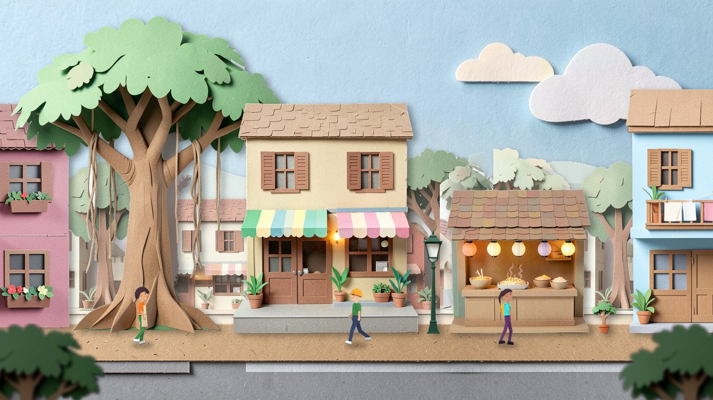

Sky, far hills, a mid row of houses and trees, the near buildings, the ground and a blurred
foreground, each a separate layer. Odalys, Lachlan and Ingrid walk along it. The camera pan shows
the layers moving at 4%, 20%, 45%, 100% and 130% of its speed:

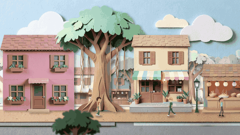

### 2. A dollhouse

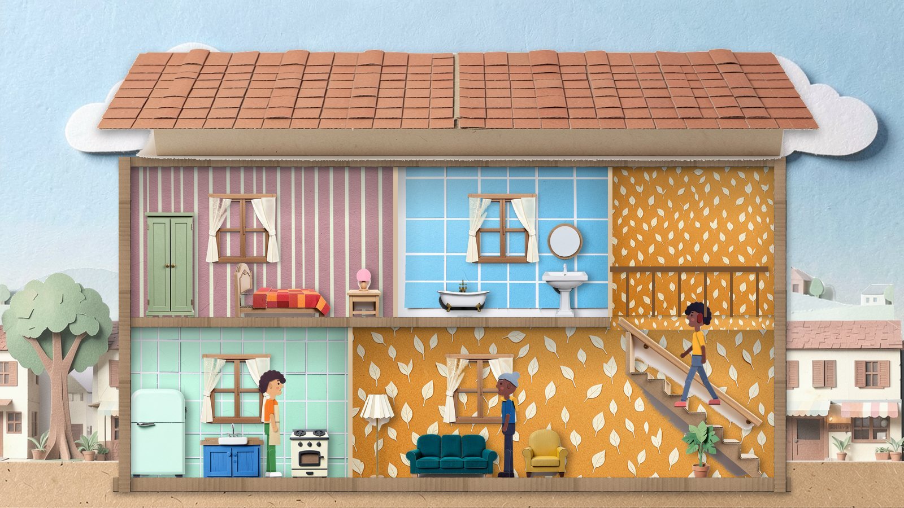

Two floors and a stairwell built from parts, not painted as one: four room papers, a cardboard
slab, a roof, a staircase, windows and twelve furniture sprites, each scaled by its height in
metres. Odalys is in the kitchen, Henrietta in the living room and Kofi on the stairs, his feet on
a line fitted to the stair sprite's treads.

### 3. A platforming section

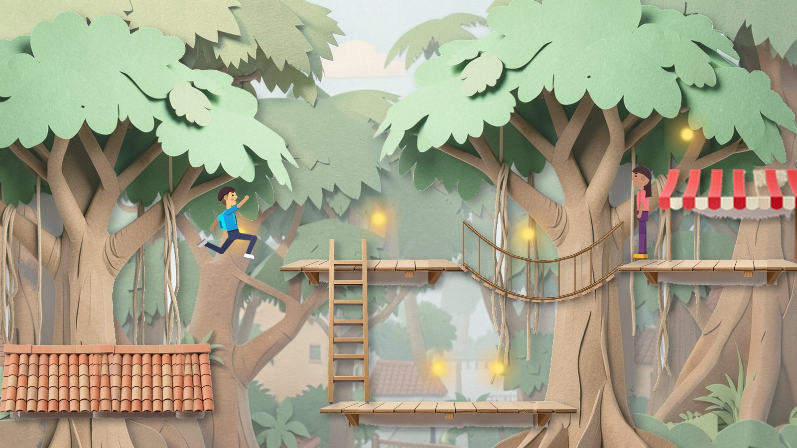

A roof ridge, plank ledges stretched to any width (their ends kept, their middles repeated), a
ladder, a rope bridge drawn along a curve from one painted plank, an awning, and the player
mid-jump. Priya waits on the far ledge.

### Walking

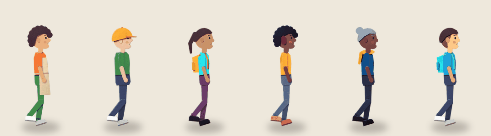

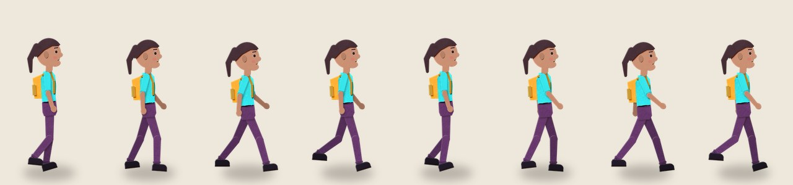

All eleven residents and the player, standing:

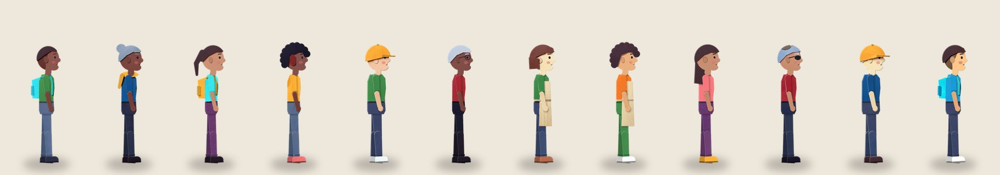

## How the residents are made

Each resident's `Appearance` (skin, hair style and colour, clothes, build, accessories) becomes
seven flat paper pieces in `doll.py`: head (with hair and headwear), torso (with apron, scarf or
backpack), upper arm, forearm, thigh, shin and shoe. They're laid out apart on a sheet, and FLUX
redraws the sheet in edit mode, with the villagers reference as the style image: "keep every piece
exactly where it is, with the same outline and colour". It keeps them in place and adds paper
texture, cut edges and a face:

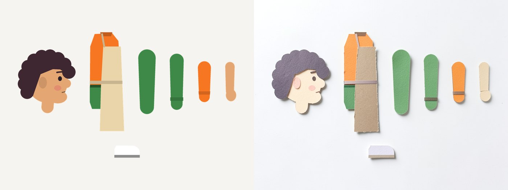

Each piece is cut along its known outline, so the joints and pivots are exact, and its colours
are pulled back to the `Appearance` (see [Consistency](#consistency)). A 2D rig places the
pieces: a pose is a set of joint angles, the far arm and leg are drawn behind and darker, and each
piece casts a soft shadow on the pieces behind it. The walk is a function of phase, the jump a
fixed pose. One FLUX call a resident, about 58 s.

Two other ways didn't work: img2img over the flat sheet kept flat vector art at strengths 0.5
and 0.7,
and a text prompt for "paper doll parts" draws one whole doll in a dress.

## The questions

### Consistency

**Separately generated pieces look like one world when they share the style prompt and a style
image.** Every scene above is 9 to 27 separate paintings. Edit mode with the references pulls
them all to the references' muted, pastel, beige-card palette. The same assets from the text
alone, same prompts and seeds, are brighter and more toy-like, but still consistent with each
other:

| Edit mode with the references | Text alone |
|---|---|
|  | 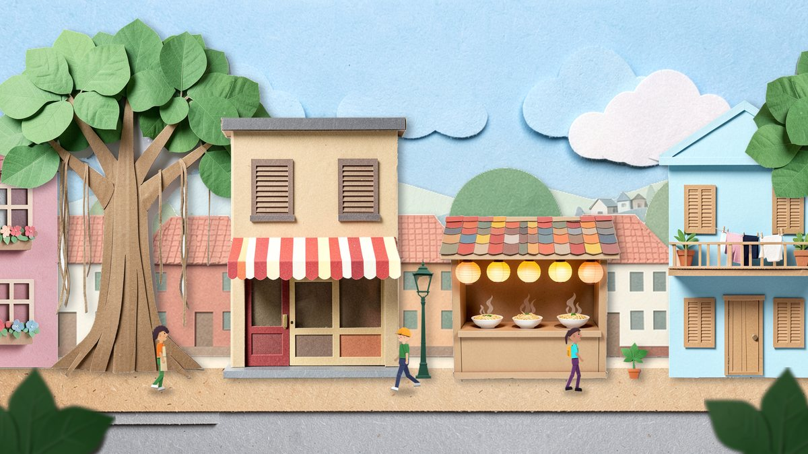 |
| 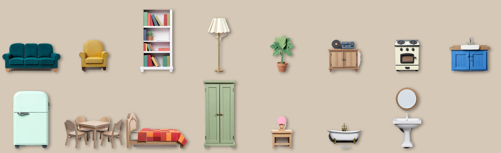 | 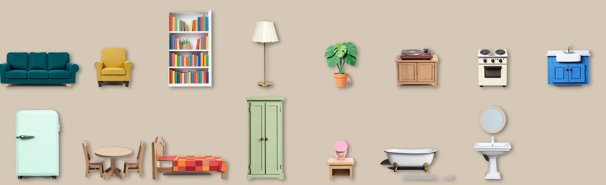 |
|  | 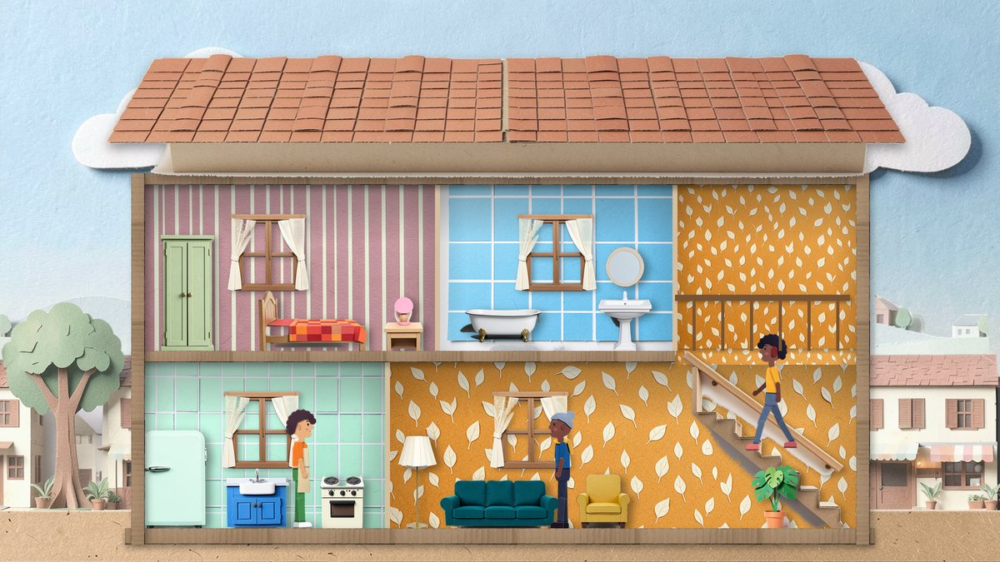 |

In the dollhouse only the furniture changes; its walls, roof and stairs are referenced in both.

Measured as the mean CIE76 distance from each asset's eight main colours to the nearest of the
references' colours, the referenced assets sit at 11.5 and the text-only ones at 13.4; the
referenced one is closer for 23 of 32 assets (`compose.py consistency`).

What edit mode gets wrong:

- **It copies objects from the reference.** The dining set is the furniture reference's beige set,
  chair for chair, and the café is close to the street reference's shophouse.
- **It drifts colours towards the reference.** The villagers reference has only light skin, and
  painting the residents' sheets turned Desmond, Kofi and Ingrid light-skinned and Henrietta's grey
  hair mint. `doll.cut_from_sheet` scales each piece's colours back to the `Appearance` (90% of the
  way), which keeps the texture. Anything with identity colours needs this, or the residents'
  colours in the prompt.
- **It paints in what it sees.** The first mid layer had little people on its street, frozen in
  place. "No people" fixed it, but every painting needs a look.

In either mode, "no text, no lettering" doesn't fully stop lettering: the mid layer's café has a
small sign of made-up, illegible letters, which shows in the street and behind the dollhouse.

### Side-on characters that walk

Yes, by building them rather than prompting for them. The references' villagers all face forward,
and no prompt reliably turns them. Here the outline of every piece is drawn in code from the
`Appearance`, so the residents are side-on by construction, and FLUX only paints over them. The
rig is cut-out animation: rigid pieces that rotate at joints, which suits paper. A new pose
(`Pose`'s sitting, reading, working, looking) is a function of joint angles, with no new art.

The parts sheet is the character creator's natural shape: the same seven pieces for everyone,
with hair styles, builds and accessories as swaps, and a new resident's flat doll shows at once
while FLUX paints theirs.

### Furniture as sprites


- **Clean alpha.** `cutout.py` combines IS-Net's mask with a colour key on the white background.
  IS-Net alone drops pale parts (a cream awning stripe), and the key alone keeps the painted
  shadows and the gaps between a ladder's rungs:

  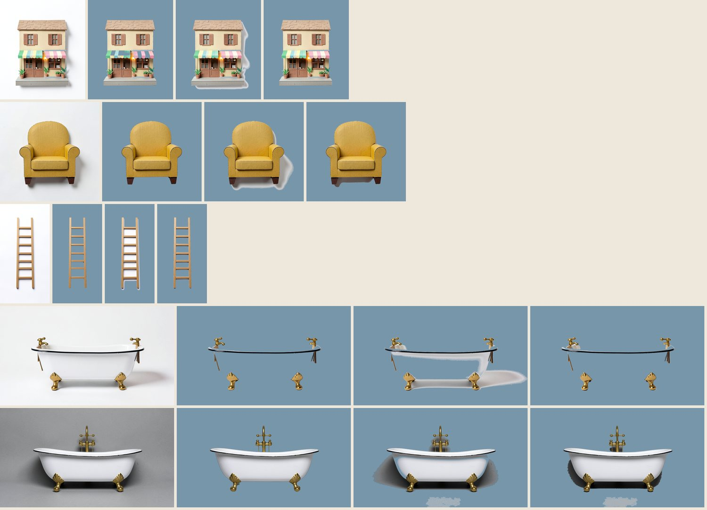

  White on white defeats both: the first bathtub (fourth row) lost its body. Painting white things
  on grey fixes it (last row), so the asset list paints the bathtub and basin on grey.
- **Varied materials.** Asking for each material by name works: teal velvet, mustard fabric, brass,
  terracotta, cream enamel, blue-painted wood, mint metal, a patchwork quilt, sage paint, white
  enamel. The references' all-beige card came from asking for "furniture" alone. The enamel and
  ceramic come out photographic rather than papercraft.
- **Consistent scale.** Generated sprites have no scale, so each has a height in metres in
  `assets.py` and is scaled to it (here 120 px/m). The residents are drawn 20% over true scale, as
  the references draw them.
- **Colour variants.** Edit mode recolours a sprite and keeps everything else, about 17 s each
  (first four below: the original and three variants). A hue shift at runtime (last three) is
  instant but cruder:

  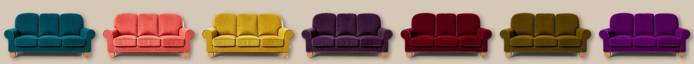

- **Shadows: draw them at runtime.** Painted shadows come out inconsistent, from a grey smear to
  nothing, and point wherever each painting's light was. A shadow from each sprite's alpha, offset
  and blurred, is uniform across sprites and can follow the time of day. Baked (left of each pair)
  and runtime (right):

  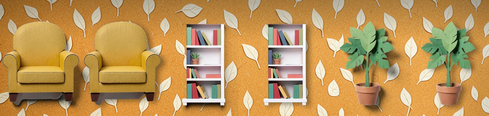

### Time of day

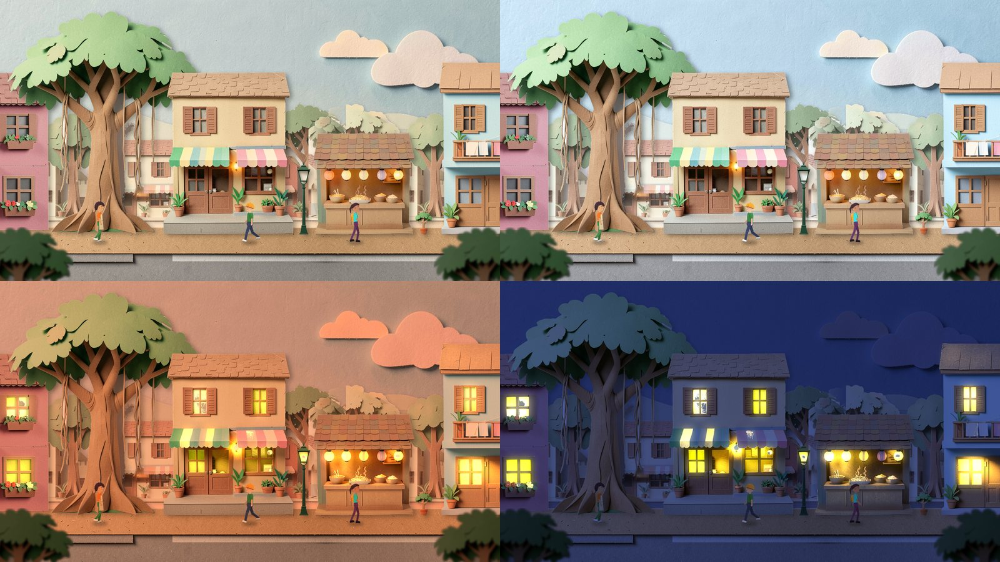

A tint per time, multiplied into each layer, with distant layers hazed towards the sky. Lit
windows and lamps come from one extra edit per building ("the same picture at night"), which keeps
every shape in place: what's warm and bright in it and not in the day painting becomes an emission
map, added on top at night (full) and in the evening (55%). Residents near a lamp are lit by it.
Tint alone, tint with the emission map, and FLUX's own night painting:

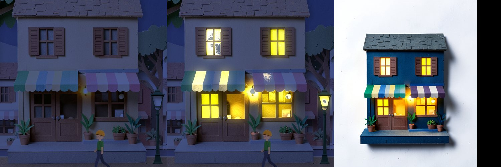

The glow map leaks wherever the night painting brightened something that gives off no light. The
café's cream awning stripes glow, and its upper-left window is speckled where the night painting
has reflections in the glass (middle picture, and the night quarter above). Limiting the map to
where light can come from, such as windows and lamps, or checking each map by hand would fix it.

So time of day costs one 29 s painting a building, rather than #116's four lighting sets, and
fades are a tint change rather than a crossfade between sprites.

### Cost

Measured on an M2 Max (96 GB), bf16, 4 steps, with nothing loaded in Ollama:

| | Paintings | Seconds each |
|---|--:|---|
| From text | 41 | 16.6 mean (8 to 34, by size) |
| Edit mode, one style image | 41 | 25.3 mean (11 to 65) |
| Night edits | 6 | 29 |
| Colour variants | 3 | 17 |
| Paper-doll sheets (two images, 1024 × 768) | 12 | 58 |
| Quantized, for comparison | 4 | 18 to 23 |
| **All** | **107** | **45 min** |

- **The model.** 15.9 GB as downloaded. In memory it's 16.0 GB at bf16, 8.6 GB at 8-bit and
  4.6 GB at 4-bit (quantized as it loads). Quantized isn't faster on this M2 (the armchair:
  13.4 s, 19.6 s, 18.0 s; the café: 22.7 s, 22.6 s, 22.5 s). The armchair comes out all but
  identical at each, while the café keeps its layout but changes its roof trim, door and awning
  colours (below: bf16, 8-bit and 4-bit).
- **Cutting out.** IS-Net (179 MB) takes about 2 s a painting on the CPU, after 20 s to load.
- **Compositing.** Every picture here in 55 s of Python. A street frame takes 0.3 s; in Phaser
  it's a few dozen textured quads.
- **Disk.** Eighteen sprites at 120 px/m (the furniture and three buildings) average 197 kB as
  PNG and 23 kB as WebP at quality 85.

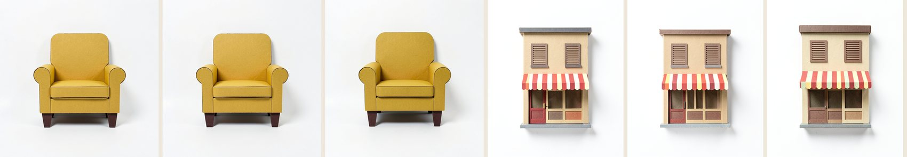

**A whole village, estimated** from those numbers: 3 streets of 4 layers (6 min), 16 buildings
with night maps (15 min), 10 room papers and 10 doors, windows, stairs and roofs (7 min),
60 furniture items (25 min) plus 3 colour variants each (51 min), 10 platform pieces (4 min) and
12 characters (12 min). About **2 hours of machine time**, 70 minutes without the variants,
plus a human look at every painting: 8 of this study's 99 distinct paintings needed a second
prompt. As WebP that's about 10 MB, against #106's 13 MB estimate for the pre-rendered 3D set.

**Build time against play time:**

- **At build time, committed:** every layer, building, room, furniture item and platform piece,
  the night maps, and the eleven residents' and the player's painted parts. CI never runs FLUX.
- **At play time, instant:** the rig and its poses, tints and emission, shadows, parallax, and
  hue-shifted colour previews.
- **At play time, through FLUX:** a new resident or a changed look in the creator (58 s, showing
  the flat doll meanwhile), and a new furniture colour (17 s). Like #296's murals, that needs the
  `images` extra on Apple Silicon; elsewhere the flat doll stays.

## Recommendation

**Switch to the side view, in papercraft, with this pipeline:**

1. FLUX.2 Klein 4B in edit mode with the references as style images, for every asset, at build
   time. Describe materials and colours by name, ask for "no people" in layers, paint white things
   on grey.
2. IS-Net plus the colour key for cut-outs, and a height in metres beside every prompt.
3. Paper-doll residents from `Appearance`: flat pieces, painted in edit mode, cut on their
   outlines, colours restored, rigged in the client.
4. Runtime drop shadows, runtime tints, and one night painting per building for its lights.

It answers what #295 hoped for: the dollhouse is a real cardboard dollhouse built from parts the
player could rearrange, characters are paper dolls a creator can swap pieces on, and layers give
parallax and platforms for free. The cost is a couple of hours of machine time for a village, and
a human pass over every painting.

**Needs a human's eye:**

- The dolls' proportions: slim and side-on, against the references' chunkier front-facing
  villagers. Bigger heads or wider bodies are numbers in `doll.py`.
- Whether the dolls' paper texture is strong enough at street size, where they read more as flat
  cut-outs than the furniture does.
- Every resident's colours, especially skin, after the drift above.
- The evening tint (orange-pink, perhaps too strong) and morning (barely different from
  afternoon).
- The enamel bathtub and basin, which look photographic next to the card.
- Each building's glow map, for leaks like the café's awning.

## What wasn't tested

- Anything in Phaser: the rig, tints, shadows and parallax are Python composites here, not the
  game. The numbers for a frame are Python's.
- Jumping as gameplay: the platforms and the jump pose are a picture.
- The village estimate is extrapolated from 107 paintings, not made.
- Linux and CI: FLUX and IS-Net were only run on this Mac.

## Files

| | |
|---|---|
| `common.py` | Paths, the references' style prompt, and `Painter`: FLUX.2 Klein 4B through mflux, plain or edit mode, cached and timed |
| `assets.py` | Every painting's prompt, size, style image and height. `python assets.py [group …]` with groups `street`, `house`, `furniture`, `swatches`, `platforms`, `night`, `dolls`, `q8`, `q4` |
| `cutout.py` | IS-Net, the colour key and their combination; baked and runtime shadows |
| `doll.py` | Paper-doll pieces from `Appearance`, the parts sheet, the colour restore, the rig and its poses |
| `compose.py` | The scenes, time of day, the walk, the comparison sheets and the numbers above. `python compose.py [step …]` |
| `migration-issue.md` | The draft follow-up issue for the migration |

To make it all again, from `server/` with nothing loaded in Ollama:

```bash
uv sync --extra images
uv run --extra images python ../docs/side-view-study/assets.py
uv run python ../docs/side-view-study/compose.py
```

`assets.py` reads the cached FLUX weights offline, and `cutout.py` downloads IS-Net
(`isnet-general-use.onnx`, 179 MB, rembg's release, checked against its MD5) into `out/models/` the
first time. Paintings, cut-outs and full-size pictures go to `out/`, which is gitignored. The
scripts import the server package only to read `content/npcs/` and the player's look. They pass
the server's ruff config, though `make lint` doesn't reach this folder.

Every painting, cut-out and full-size picture, including the pilots and the first attempts, is on
the orphan branch
[`previews/295-side-view-study`](https://github.com/mentaldesk/simile/tree/previews/295-side-view-study).
