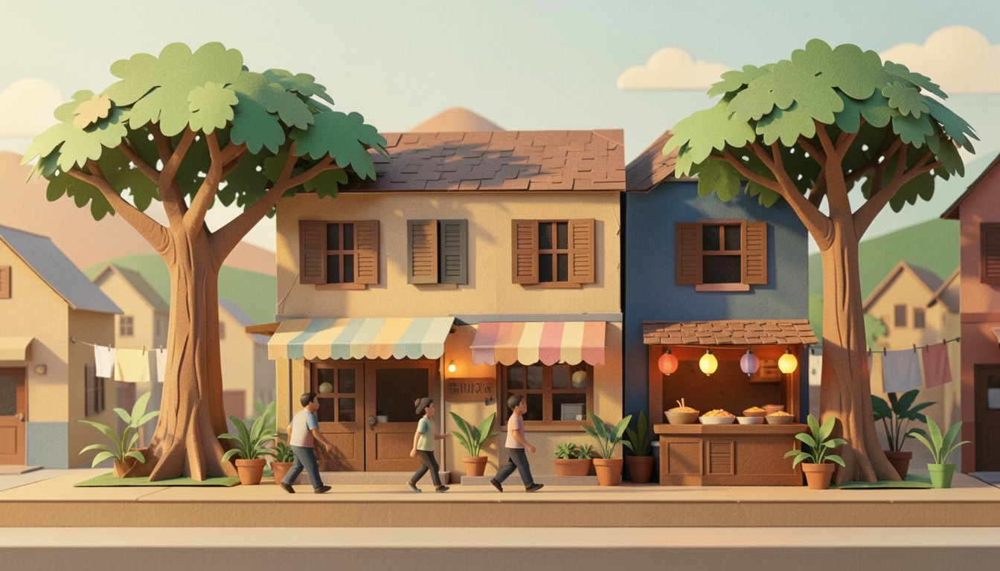
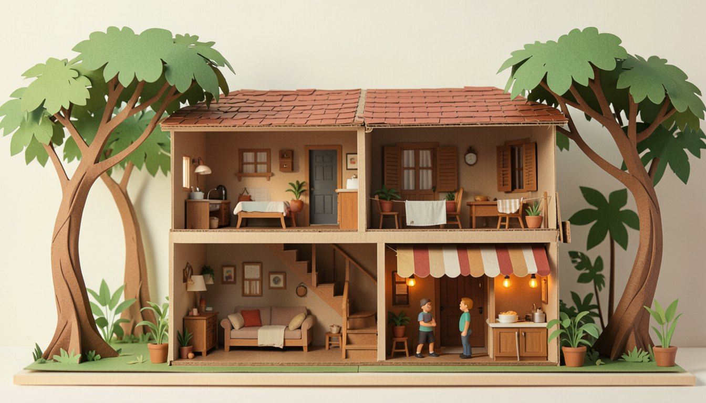
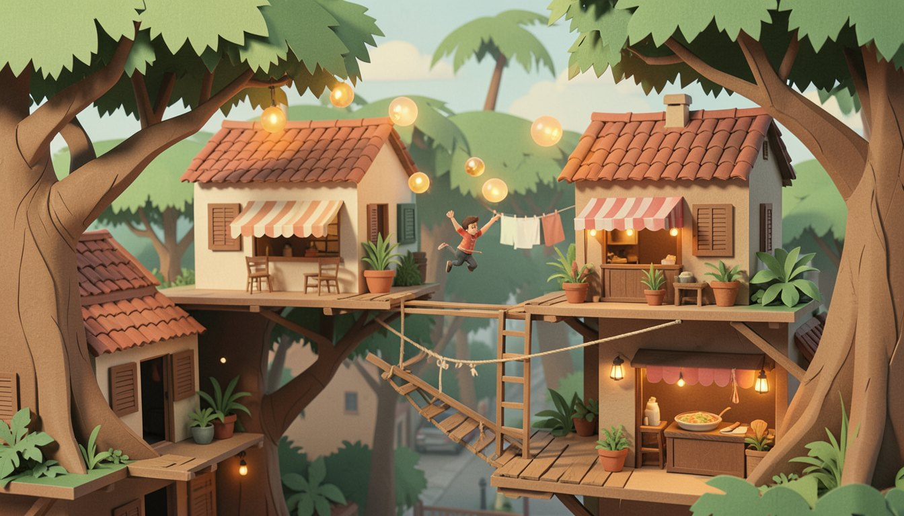
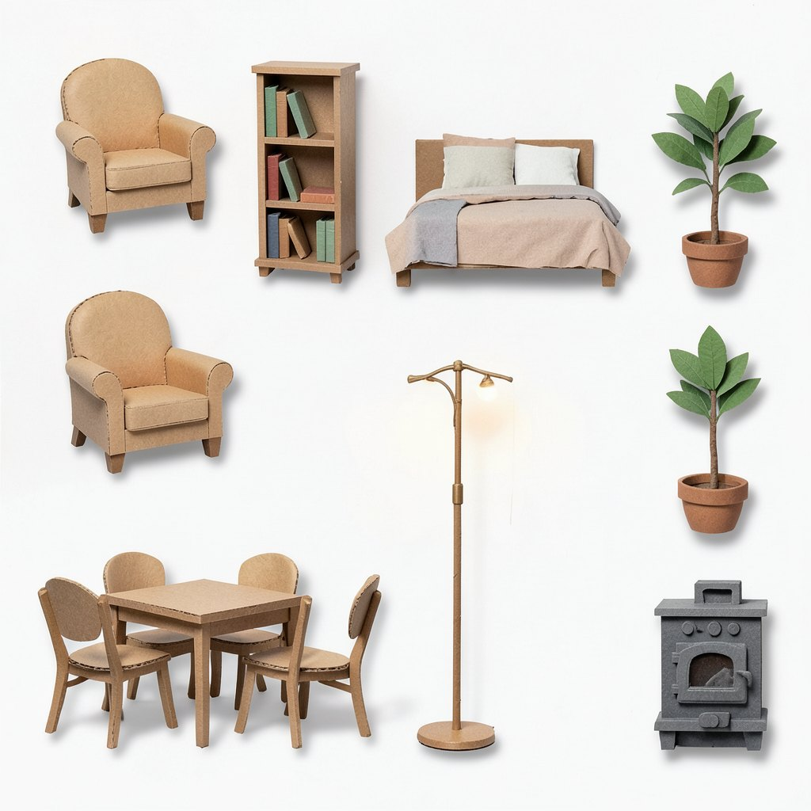
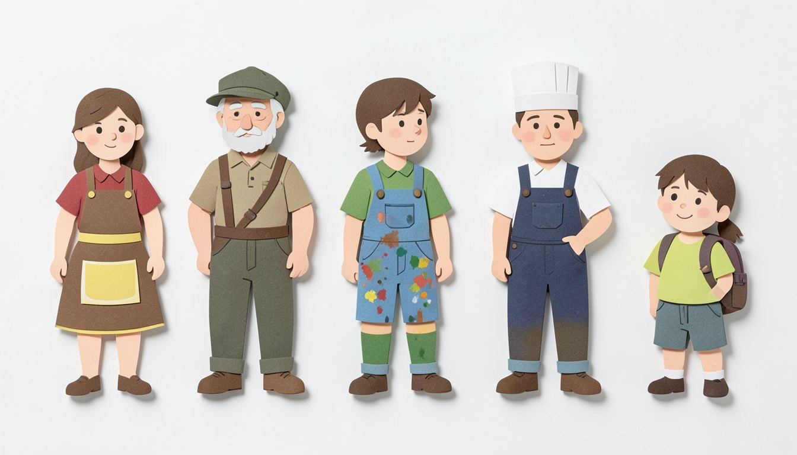

# Papercraft references (#295)

The papercraft look picked for the side-view study, generated on five scenes set in Simile's village.
They're references for the style, not game assets: each is one picture from one prompt, with no
retouching.

| | |
|---|---|
|  | **Street.** Walking through the village, with background layers for parallax. |
|  | **Dollhouse.** A two-storey house with the front wall cut away: where building and furnishing would happen. |
|  | **Rooftops.** A platforming section in the treetops and rooftops. |
|  | **Furniture.** Separate items on white, to see if generated objects could become sprites. |
|  | **Villagers.** Five residents in a row, to see if different characters come out in one style. |

Papercraft was picked from five styles tried on the same scenes: painterly, pixel art, ink and
watercolour, flat cartoon and papercraft. What it showed:

- The dollhouse comes out as a cardboard dollhouse, and the villagers as paper dolls.
- Layers of card give parallax for free.
- Almost all the furniture is the same beige card, and the floor lamp looks like real metal.
- The villagers face forward, not side-on. That happened in every style, so it needs its own prompt
  or a pose reference.

## How they were made

FLUX.2 Klein 4B (Apache 2.0) through [`mflux`](https://pypi.org/project/mflux/) on Apple Silicon,
at 4 steps with seed 42, about 30 s an image. `gen.py` has the exact prompts. To make them again:

```bash
cd docs/side-view-study/references
uv run --python 3.13 --with mflux --with 'pillow<13' python gen.py /tmp/papercraft
```

The first run downloads about 16 GB of weights from Hugging Face. `mflux` 0.23 fails to import with
Pillow 13, hence the pin. The images here are the PNGs saved as JPEG at quality 86.

Two things the prompts learned the hard way:

- **Describe the look, don't name games.** "Like Rayman Legends and Ori" painted "ORI" on a shop
  sign.
- **Ask for platforms, not props.** "Rooftops, ladders, wooden ledges" drew another street.
  "Flat walkable platforms at many different heights with open gaps between them" and a hero in
  mid-air drew a level.
