# Style studies 2 and 3: a near-future Shenzhen village (#326, #329)

After playing the side view, the user found the papercraft had taken the village back to the
1950s. #326 rebuilt #295's pieces two ways and compared them. #329 adds three more styles, and finds
out why #295's pictures looked sharper:

1. **Papercraft with modern references** (#326).
2. **A Klei-like cartoon** in the spirit of Oxygen Not Included (#326).
3. **The Klei-like cartoon, revised** (#329): scratchier and grimier, with much bigger heads and one
   outline.
4. **Pixel art** (#329).
5. **A flat cartoon** (#329): flat modern illustration, with no outlines and no texture.

The pieces are the same as #295's: a street in parallax layers, a dollhouse interior with
furniture, and paper-doll residents seen from the front, the side and the back, with a walk.

Nothing here changes the game. Every piece is painted, cut out and scaled by the game's own
pipelines, run read-only with this study's references, prompts and front plans:

- **Scenery:** #309's `simile.papercraft.build.Build`, the game's `layout.json` and `EditPainter`.
- **Residents:** #310's `simile.dolls.build.paint`, with its sheets, cut and colour restore.

The scenery keeps the game's manifest keys, so `simile.papercraft.preview` composes High Street and
the coffee shop's dollhouse on the real maps. The residents are posed by a Python port of the
client's rig (`client/src/dolls/rig.ts`). FLUX.2 Klein 4B runs through mflux at 8 bits, as the
game's builds do. No picture is painted whole.

**Contents:** [the references](#the-references) · [sharpness](#sharpness) ·
[side by side](#side-by-side) · [each style](#each-style) · [the numbers](#the-numbers) ·
[recommendation](#recommendation) · [what wasn't tested](#what-wasnt-tested) · [files](#files)

## The references

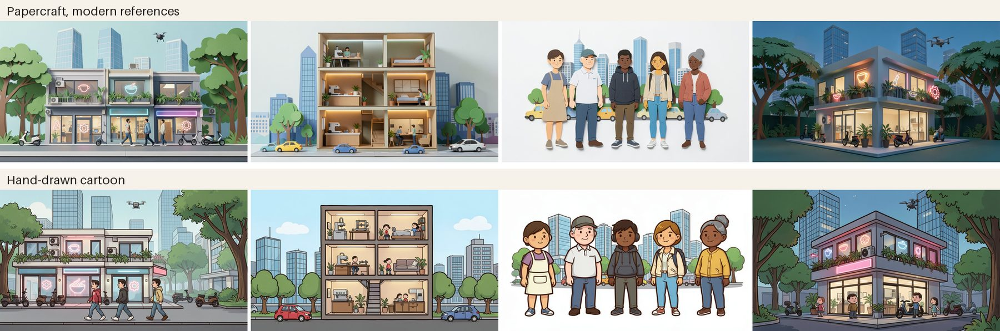

There are four references for each style: a street, a dollhouse interior, residents, and a shop
with neon signs. Each one is painted from text alone (`references.py`).

- **The period is described outright:** glass towers behind low-rise shops, AC units, balconies
  full of plants, e-bikes, a delivery drone, banyan trees and contemporary clothes.
- **Signs are neon pictograms,** never boards. Asked for "LED sign panels", FLUX wrote
  pseudo-Chinese characters on every one. A sign is now "a glowing neon pictogram in the window: a
  coffee cup, a noodle bowl or a gear". The user likes them, so #329 keeps them.
- **Even so, FLUX keeps adding small signs,** and the new styles more than the old.
  - #326 rejected 18 of 26 references, all but one for lettering.
  - #329 rejected 22 of its 34, every one for lettering: on a sign band, a vertical blade sign, or
    a shop in the background. Pixel art drew pseudo-Chinese on almost every sign band.
  - Pixel art's shop took eight seeds. Seven had lettering, and the kept one had one small icon
    that could be read as a character. It's painted out of the kept copy, blended across from the
    panel either side. The revised cartoon's street took six seeds and pixel art's six.
  - Each kept reference was looked at whole and zoomed in on every sign, window and wall box.
- **The residents reference names each skin tone,** from pale to deep brown.
- **Every style is described, never named.** Everything in each reference is asked to be made the
  same way, or FLUX paints paper trees in front of photographic buildings:
  - **The Klei-like cartoon:** "very thick bold dark brown outlines around every shape, flat colours
    with simple soft shading, chunky rounded shapes, slightly exaggerated proportions".
  - **Revised:** "thick dark brown ink outlines that are scratchy, uneven and slightly broken, as if
    drawn with a worn dip pen ... smudges, scuffs, stains and grime on every surface, a slightly
    dirty, muted palette", and residents with "very big round heads on small bodies".
  - **Pixel art:** "crisp square pixels all of one fixed size, a limited palette of flat colours
    with two or three shades each, no anti-aliasing, no gradients, no blur".
  - **Flat cartoon:** "bold flat colours, simple geometric shapes, clean smooth edges, no texture,
    no grain, no gradients, no dark outlines, at most a thin line in a darker shade of the same
    colour".

## Sharpness

The user found #295's study "had much sharper imagery and looked better quality overall". #329
painted a few pieces each way to find out why: at 8 bits and at bf16, at 1.5 times the pixels, and
from text alone rather than in edit mode. Then it stored, cut, framed and encoded them each way
(`sharpness.py`).

**It's the camera. #295 drew its pictures at one and a half to two times #326's pixels a metre,
and the client draws about that much on a retina screen.**

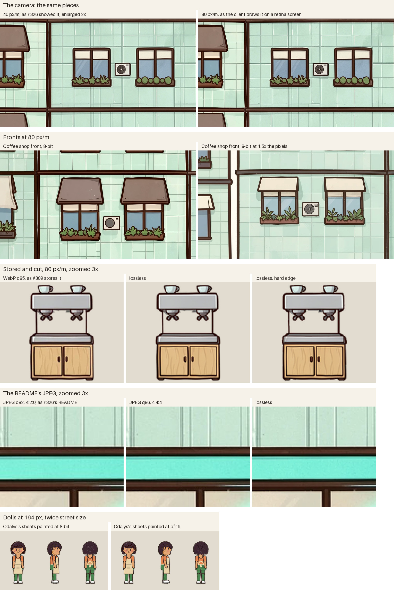

| | #295 | #326 | The client, 19 m view |
|---|--:|--:|--:|
| Street | 65 px/m | 40 px/m | 47 px/m on a 1× screen, about 95 px/m on a retina screen |
| Dollhouse | 95 px/m | 49 px/m | as the street |
| A resident on the street | 133 px | 82 px | about 195 px on a retina screen |
| Comparison pictures | 1600 px wide | 1200 px wide, so a retina browser enlarges them | |

The client sizes its canvas in device pixels (`world/canvas.ts`) and fits 19 m to its height
(`side/camera.ts`). #326's play size, 40 px/m, is a 760 px tall window on a 1× screen. The same
pieces drawn at 80 px/m (above, right) look as sharp as #295's, since every piece is stored at
#309's 120 px/m.

**The other candidates make little or no difference:**

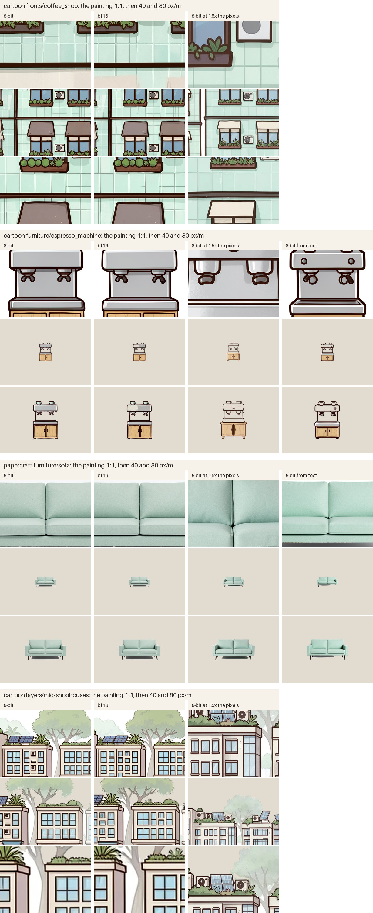

| | What it does | Cost |
|---|---|---|
| **bf16 rather than 8 bits** | Nothing you can see. The fronts, furniture and dolls come out the same, line for line. The mid layer moves a few windows. | 20% *faster* on this M2 Max (a front unit 53 s rather than 66 s, a doll sheet 42 s rather than 53 s), but 16.0 GB of weights rather than 8.6, and peaks 7 GB higher (27.6 GB rather than 20.2 for a front unit) |
| **1.5 times the pixels** | Furniture is already painted at 250 to 400 px/m, far more than any screen shows. Fronts are painted at about 103 px/m, about what a retina screen draws. At 154 px/m the café front has finer tiles and leaves at 80 px/m, but thinner outlines than every other piece, and a different layout. A bigger layer or sprite only draws smaller things in it. | 2.1 times as long (139 s a unit) and 34.6 GB at peak |
| **Text mode rather than edit mode** | Bolder, not sharper: the cartoon espresso machine came out with heavier detail, and the papercraft sofa much the same. Without a reference, each piece's style drifts from the rest, as #295 found. | half the time (12 s rather than 24 s) |
| **Hard cut-out edges** | Jaggies. #309's soft, unmixed edge is right. | |
| **Lossless pieces rather than WebP q85** | Invisible: ΔE 1.1 to 1.5 from lossless at 80 px/m | 13 times bigger for a front (4.1 MB rather than 308 kB) |
| **JPEG q86 at 4:4:4 rather than q82 at 4:2:0** | Thin coloured lines stay crisp: ΔE 0.84 from lossless rather than 1.24. 4:2:0 halves the colour resolution, which smears a teal light band into the wall. | a third bigger |

**So every final picture here is drawn the sharper way**, #326's two styles' included, from their
same pieces with nothing repainted:

- the street close-ups at 80 px/m, as the client draws them on a retina screen
- the dollhouses at 60 px/m
- the comparisons at full size, 1600 px wide, with nothing shrunk
- JPEG at 4:4:4

**For the game's builds (#309, #310):** change nothing in the painting. Keep 8 bits, the painting
sizes and WebP q85. Draw `simile papercraft-preview` at the client's real size, about 95 px/m on a
retina screen, or at least twice its 40 px/m, before judging a piece. bf16 is a speed option, 20%
faster for 7 GB more, not a sharpness one.

## Side by side

The game today, then the five styles, from the same maps and residents. The street is 1:1 at
40 px/m, the client's size on a 1× screen:

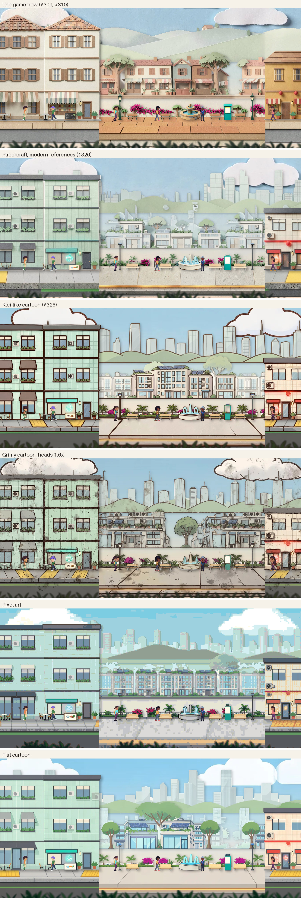

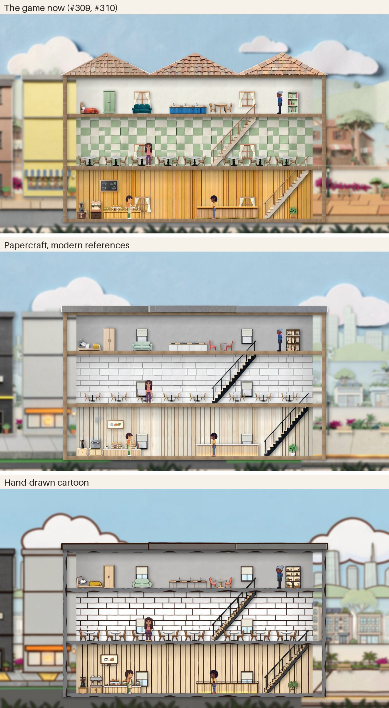

The residents at about two and a half times street size, the revised cartoon at both head sizes:

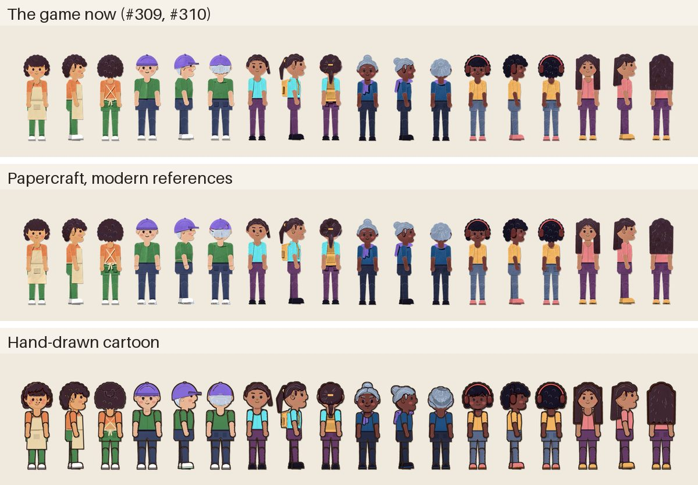

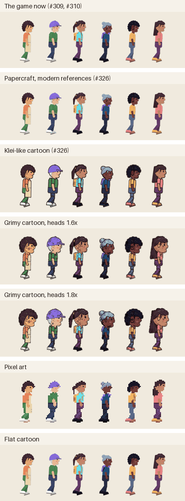

At play size, 1:1: on a 1× screen at 40 px/m (left), and on a retina screen at 80 px/m (right):

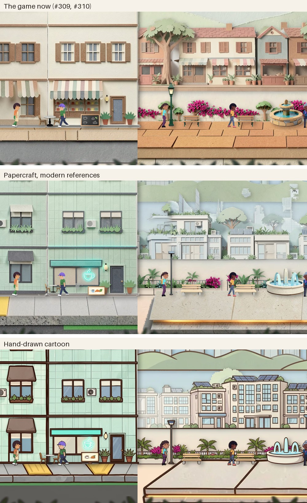

**All five read as today's Shenzhen,** from the same prompts and plans: the glass skyline, mid-rise
blocks with solar panels and roof gardens, AC units, tiled fronts, solar street lamps, a smart
kiosk and the neon pictograms. They differ in how they draw it:

- **The revised cartoon** is the Klei-like cartoon with its surfaces worn: scratchy, broken ink,
  smudges, drips under the windows and scuffed paving. Its palette is the most muted of the five.
- **Pixel art** is the crispest at play size, but it's pixelated painting more than drawn pixel
  art. Big flat shapes (walls, awnings, windows, the kiosk) come out as clean pixel art. Fine
  painted detail (the far towers, the mid blocks' windows, the tile grid on the fronts) breaks into
  noisy blocks, since no pixel artist chose where its pixels go.
- **The flat cartoon** is the cleanest and the most modern-looking. With no outlines, the mid blocks
  and towers separate from each other by colour alone, and pale furniture sits close to pale
  walls.

## Each style

### Papercraft with modern references (#326)

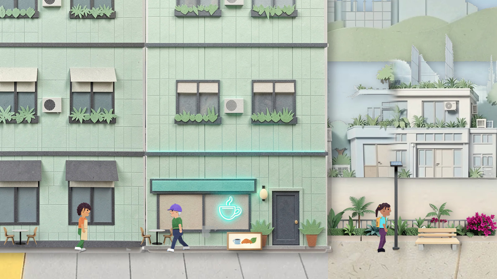

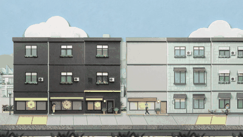

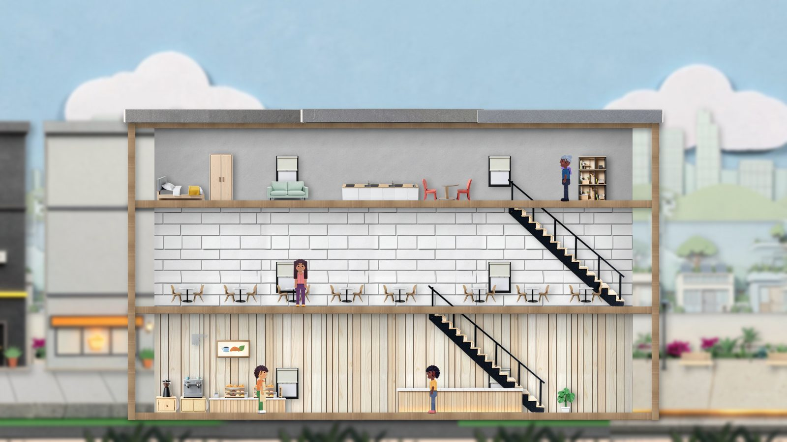

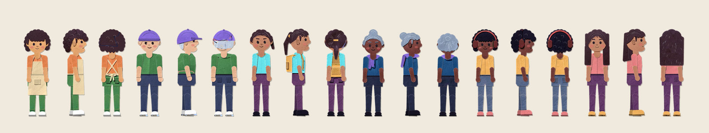 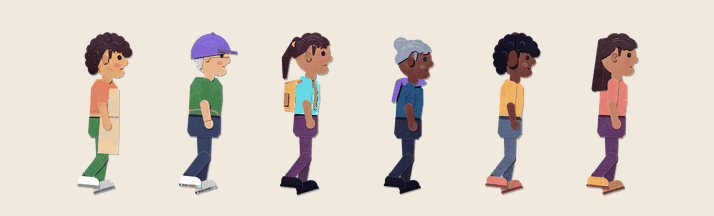

The pieces: [fronts](images/papercraft-fronts.jpg), [furniture and platforms](images/papercraft-furniture.jpg),
[layers and papers](images/papercraft-layers.jpg), and [walk frames](images/papercraft-walk-frames.jpg).

**Does the period still drift? Not with today's prompts and plans. The references alone change
almost nothing.** Below, #309's own prompts (left), the same prompts and seeds with the modern
references (middle), and this study's prompts (right):

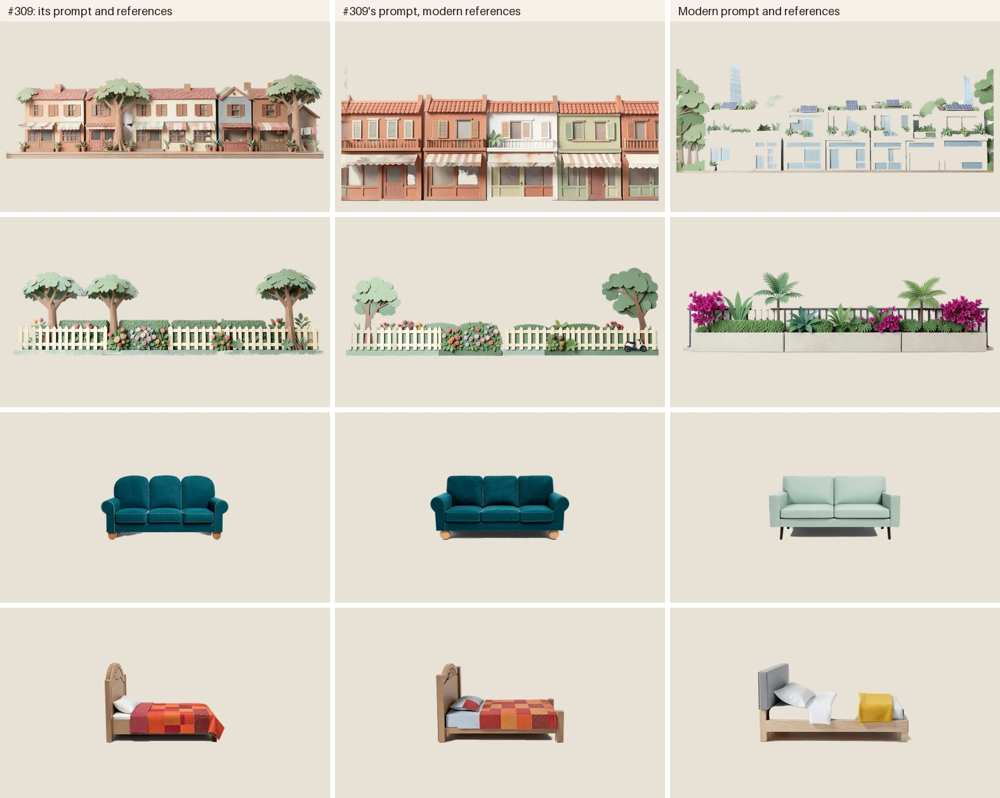

With the modern references, #309's prompts still give tiled shophouses with shutters and striped
awnings, picket fences, a velvet sofa on round wooden feet and a carved bed with a patchwork
quilt. The references set the medium and the palette. The period comes from the words, in three
places in #309's pipeline:

- **The prompts** (`catalogue.py`, `village.py`): shophouses, shutters, terracotta, velvet,
  brass, patchwork. Here every piece names today's materials instead: glazed tiles, charcoal
  brick, pale oak, white laminate, steel, induction hobs.
- **The front plans** (`fronts.py`). FLUX keeps to the plan, so whatever the plan draws stays:
  cream curtains, sills and lintels, striped awnings, shutters, flower boxes and tiled roofs.
  - Fronts are painted with no style image, so no reference reaches them.
  - `scenery.modernised` draws over #309's plans with today's details: slim dark window frames
    with roller blinds, a plain light band where each awning was, a lit shop window with a neon
    ring for the pictogram, and AC units. Each building gets a flat roof.
  - FLUX turns the ring into the pictogram the prompt names, and keeps the rest.
- **The references,** for the medium and palette.

**What still drifts:**

- **Modern materials don't read as paper.** Steel, white laminate and glass come out as product
  renders rather than card. Wood, fabric and plants still look cut.
- **A modern palette is pale.** White and grey walls, glass and pale oak lose the warm contrast of
  the old village, and they fight the cut-out: pale paving on white loses its top.
- **Ground strips are cut to their own band** (`scenery.banded`), as #309 cuts fronts on their
  plans, in every style. Each is made solid from its band's usual top row to its usual bottom one,
  and a plaza painted as a slab in perspective has its sloped ends trimmed. Without it, the sky
  showed through holes in the pavement.
  - The cut can only keep what the key found. Pixel art's first plaza was a pale slab over grey
    stone on a grey backdrop: the stone went with the backdrop, and the slab stood on nothing. It
    was painted again until the strip was solid to its bottom row.
  - Every style's ground strips are now opaque in every row but a few soft rows at their top and
    bottom edges.
- **The residents barely change.** #310's dolls already wear t-shirts, jeans, caps, headphones
  and backpacks, drawn in code from each `Appearance`.

### The Klei-like cartoon (#326)

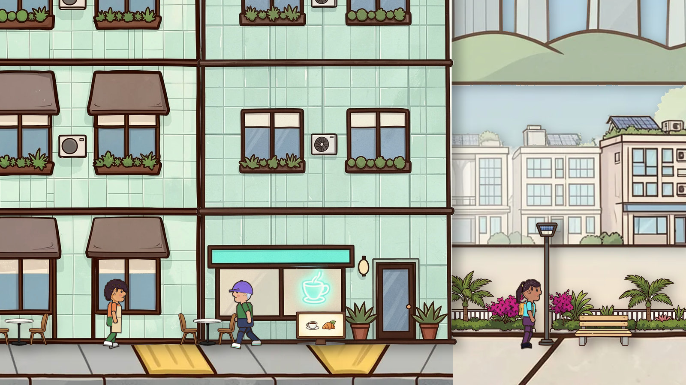

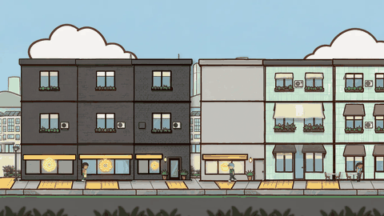

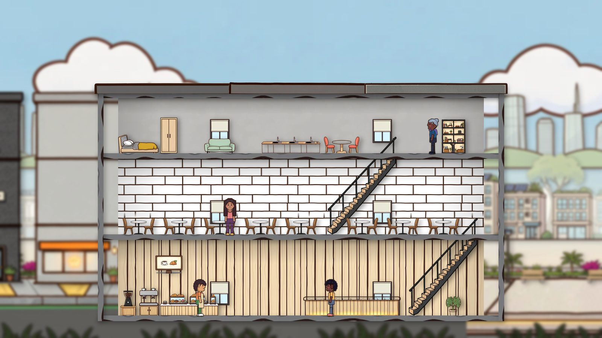

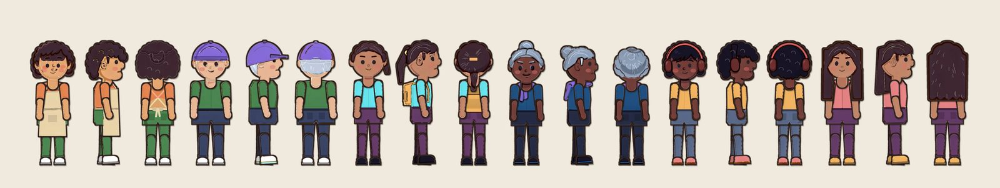 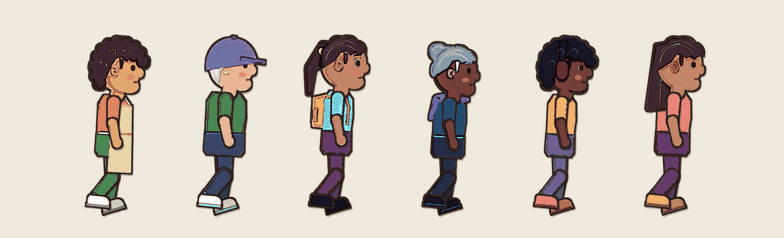

The pieces: [fronts](images/cartoon-fronts.jpg), [furniture and platforms](images/cartoon-furniture.jpg),
[layers and papers](images/cartoon-layers.jpg), and [walk frames](images/cartoon-walk-frames.jpg).

The same pieces, plans, prompts and seeds as the papercraft. Only the style text, the references
and how things are made ("hand-drawn in the cartoon style" for "made of cut paper and card")
differ. Its residents are #310's cut-out rig:

- **The side sheet works unchanged,** with #310's prompt in cartoon words.
- **The front and back sheet needed a new prompt.** With #310's wording, 4 of 6 merged the two
  torsos into a whole character. "Four separate flat pieces of a cartoon cut-out puppet, laid
  apart" kept them apart in all six.
- **#310's cut, patching and colour restore work, with one fallback** (see
  [Skin and colour](#skin-and-colour)).
- **Three additions, all numbers:** an ink outline 0.9 units wide drawn round each piece, heads
  1.22 times bigger, and bodies 1.15 times wider.
- **The outline doubles.** The painted outline sits inside the drawn one along each edge. The
  user found this "looks weird, kind of like a colouring in drawing", which #329's revision fixes.

### The Klei-like cartoon, revised (#329)

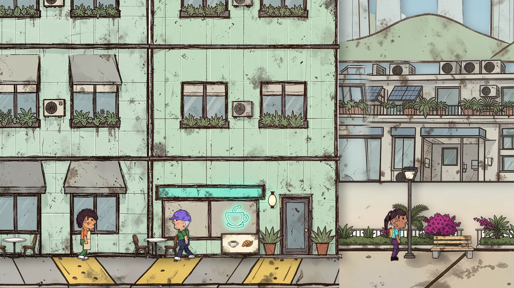

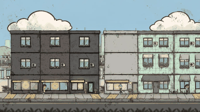

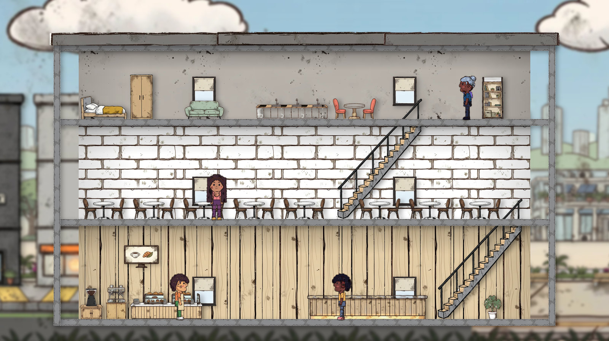

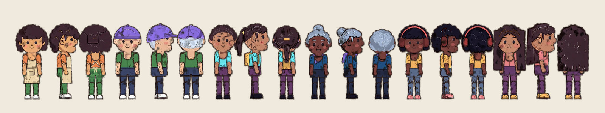 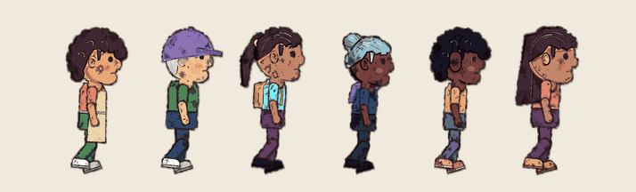

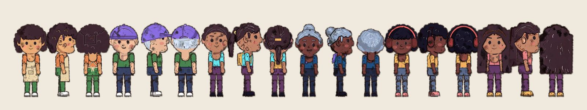

The pieces: [fronts](images/grimy-fronts.jpg), [furniture and platforms](images/grimy-furniture.jpg),
[layers and papers](images/grimy-layers.jpg), and [walk frames](images/grimy-walk-frames.jpg).

The same pieces, plans, prompts and seeds again, with new references, the style words above, and
"hand-drawn in the scratchy, grimy cartoon style" for how things are made. The neon pictograms are
as they were.

**Scratchier and grimier.** Every piece has scratchy, broken ink, smudges and stains, the walls
drip under their windows, and the palette is dirtier. It's still cleaner than Oxygen Not
Included, whose grime comes as much from its dark, cluttered colony as from its line.

**Bigger heads, at 1.6 and 1.8 times.** #326's cartoon drew heads 1.22 times bigger. Klei's
characters are mostly head, so the rig changes as well as the head:

- **The neck sinks.** A head grown about its neck pivot also grows downwards, past the chin. The
  neck joint drops by as much as the head grew below it, so the head sits down on the shoulders
  rather than floating above them (`dolls.adjusted`, `neck = -1`).
- **The shoulders drop 2 units,** so the arms come out under the bigger head rather than beside
  the ears.
- **Bodies stay 1.15 times wider,** as #326's.
- At 1.6 the residents read as cartoon people. At 1.8 they're mostly head: long hair (Priya,
  Henrietta's bun) becomes a block bigger than the body. Both are in the comparison above.

**One outline.** #326 drew an outline round each piece on top of the one FLUX painted, and the user
found the double line "looks weird, kind of like a colouring in drawing". #329 painted each
resident both ways:

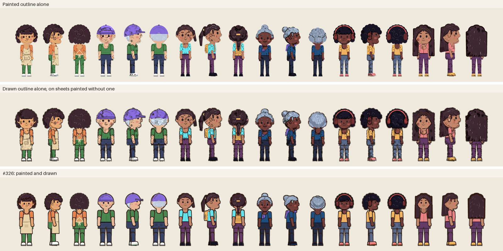

- **The painted outline alone** (top) is thin, about 0.8 units, and soft. FLUX leaves it off some
  edges, and where a forearm crosses the torso there's no line between them.
- **The drawn outline alone** (middle) is on sheets painted with "no outline round any piece". It's
  the same weight on every piece, about the weight of the scenery's painted ink, and scratchy:
  its width varies along each edge, as a worn pen's does. Every joint reads.
- **The study uses the drawn one.** It can be baked into the atlas, as #326 proposed, so the client
  is unchanged. Which to keep is the user's call.

**Its residents rig as #326's cartoon did.** The "cut-out puppet" front and back prompt kept the
torsos apart on the sheets painted without an outline, at the first seed. With the painted
outline, three of six (Odalys, Kofi and Lachlan) misplaced the back of the head and were painted
again, and Lachlan's second try shifted both torsos, which #310's patching fills in their own
colours.

### Pixel art (#329)

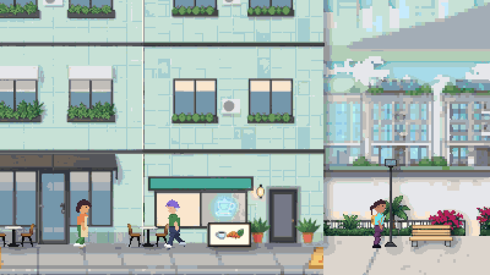

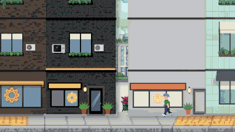

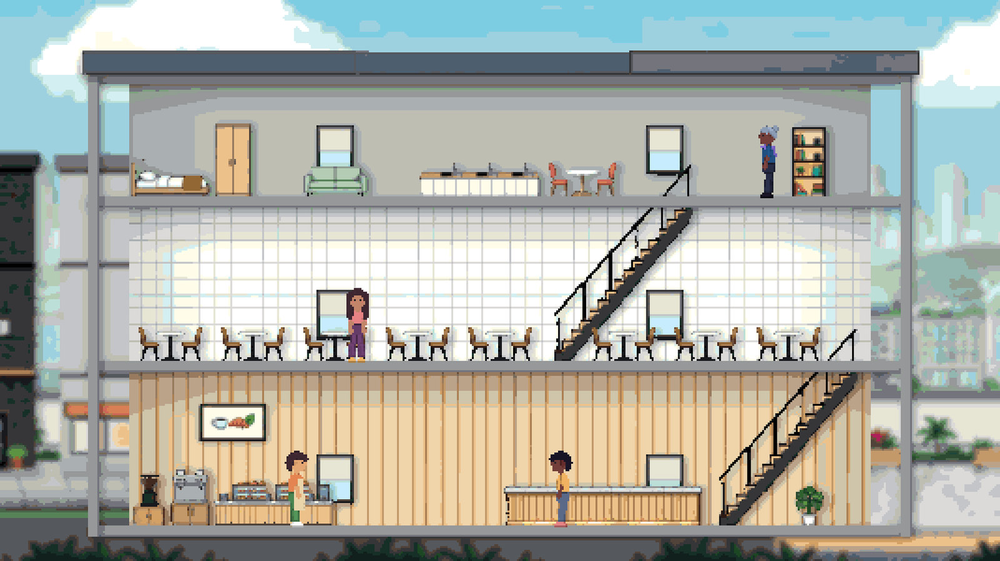

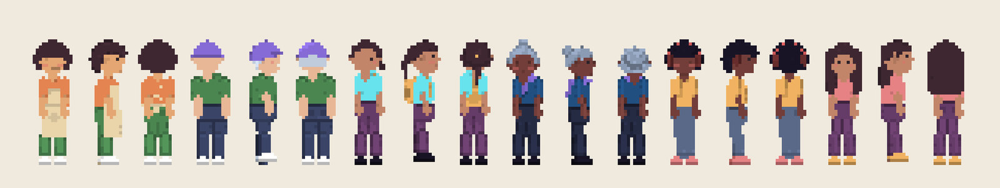
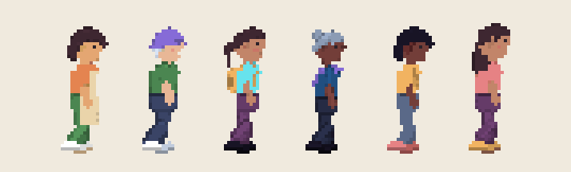

The pieces: [fronts](images/pixel-fronts.jpg), [furniture and platforms](images/pixel-furniture.jpg),
[layers and papers](images/pixel-layers.jpg), and [walk frames](images/pixel-walk-frames.jpg).

**One pixel grid for everything: 20 art pixels a metre** (`pixel.py`). A tile is 22 art pixels and
a resident about 41, near the density of modern pixel-art games. The street is drawn at 2 screen
pixels to an art pixel at play size, 4 on a retina screen, and the dollhouse at 3.

- **The pieces** are painted by #309's `Build` in pixel art words, as every style is. Then each
  piece is snapped to the grid: area-averaged to 20 px/m, its alpha made hard, and every pixel
  given the nearest colour of one 62-colour palette, with no dithering. They're stored at #309's
  120 px/m, 6 pixels to an art pixel, so `preview.py` and the manifest are unchanged.
- **The palette** is shared by every piece: the most used colours of all the pieces, at least 8
  CIE76 apart. A plain median cut gave the walls a band of near-identical greens and no magenta for
  the bougainvillea.
- **The frame** is drawn by #309's `preview.py` at a whole number of screen pixels to an art pixel,
  then snapped to the grid: each block of screen pixels takes its most common palette colour. A
  native-resolution render target in the client does the same. So pieces drawn at any position
  share one grid, and nothing is anti-aliased.

**FLUX paints pixel art loosely.** Its "pixels" vary in size within a painting and don't line up
with the grid, so the snap decides every pixel. Flat shapes come out clean. Textures don't: the
fronts' tile grids and the mid layer's windows become noisy, irregular blocks that a pixel artist
would have drawn as a pattern. It looks like good pixelated art rather than hand-placed pixels.
Painting at the grid's size wouldn't help, since FLUX can't paint at 20 px/m.

#### Does #310's rig survive pixels? Yes, drawn at the art's own size

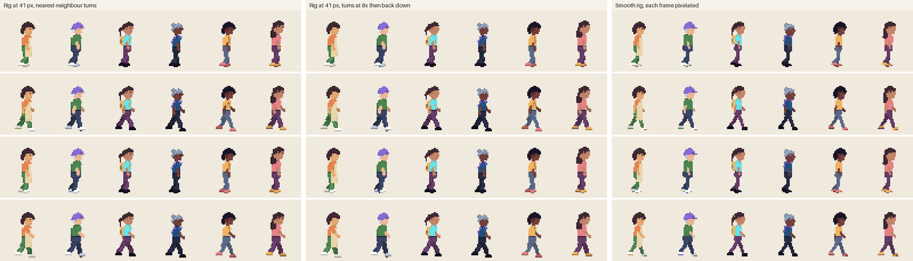

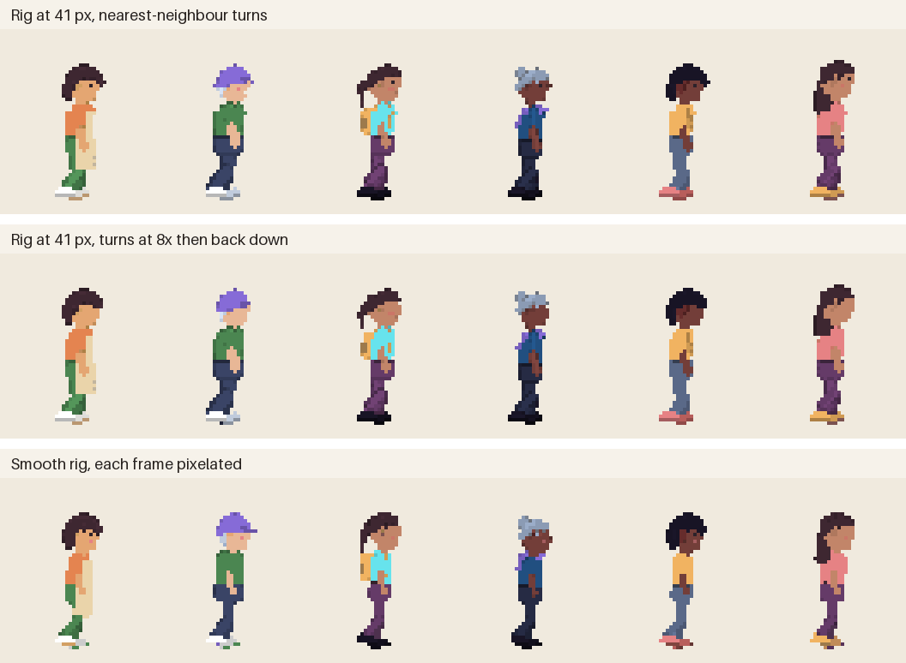

Rotating rigid parts shears and blurs pixels when the picture is scaled after the rig turns them.
So #329 drew the six residents' walk three ways at 41 art pixels tall, each scaled up by a whole
number with nearest-neighbour:

| | Stray pixels a frame (no neighbour of their colour) | Frames that fall apart |
|---|--:|--:|
| **#310's rig at 41 px, nearest-neighbour turns** | 22.5 | 0 |
| The same, each piece turned at 8× and shrunk back by majority, as pixel artists' rotation tools do | 19.2 | 0 |
| #310's rig drawn smooth, each frame pixelated: frame-by-frame poses | 21.1 | 0 |
| At half the size, 20 px tall: nearest-neighbour, 8× turns, pixelated frames | 4.0, 3.5, 3.0 | 0 |

**The rig drawn at the art's own size works as well as frame-by-frame poses,** and is what the
pictures here use:

- Each piece is pixelated once, by colour region: an art pixel takes the region that covers most
  of it, in one of four shades of that region's flat colour (`pixel.region_pixels`). So a
  resident's colours are their `Appearance`'s and nothing else, and a one-pixel ear is still skin.
- The rig places pieces at whole art pixels and turns them with nearest-neighbour. At 41 px a limb
  is 3 to 4 art pixels wide, so a turn leaves it whole: no frame breaks apart. Limbs shimmer a
  little from frame to frame, as rotated sprites do. The 8× turns are 15% cleaner, for 64 times the
  pixels to turn.
- Smooth frames pixelated afterwards are no cleaner, and would need every pose baked ahead.

**What it means for #310's rig: nothing changes in it.** The atlas's pieces are pixelated by
region at 20 px/m, the pivots scale with them, and the client draws the rig into a render target
at the art's own size with nearest-neighbour, then scales that up by a whole number. Poses stay
functions of joint angles, so sitting, reading and climbing need no new art. #329 also drew the
walk at half the size, 20 art pixels tall (`compose.py rig`, `rig.json`), and no frame fell apart
there either, so frame-by-frame poses aren't needed at either density.

### The flat cartoon (#329)

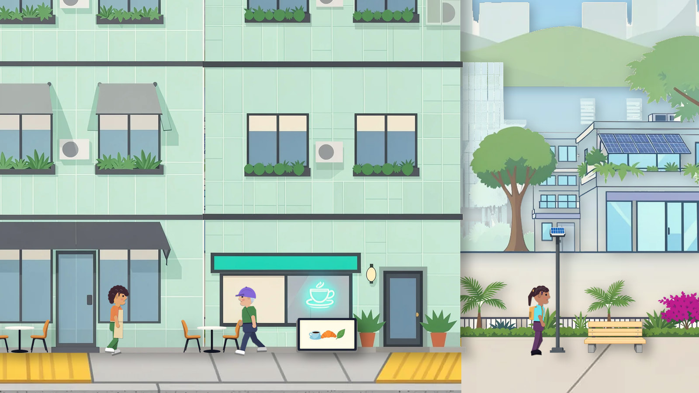

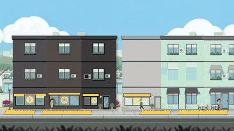

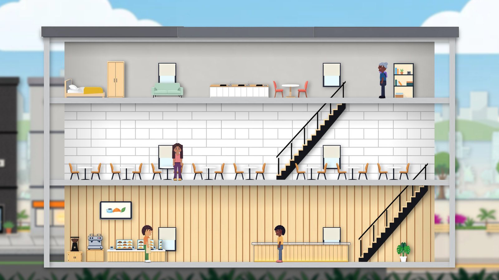

 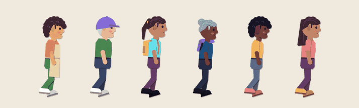

The pieces: [fronts](images/flat-fronts.jpg), [furniture and platforms](images/flat-furniture.jpg),
[layers and papers](images/flat-layers.jpg), and [walk frames](images/flat-walk-frames.jpg).

The same pieces, plans, prompts and seeds, the same rig, and #310's dolls with the flat style's
prompt ("a cut-out puppet in flat illustration ... no outlines and no texture"), and no card edge.

- **It's flat and geometric,** with no grain and no gradients. Its lines are thin and few: a
  darker shade, or a thin dark line round some furniture, where both cartoons have thick ink.
- **The dolls need the least fixing of any style:** every front and back sheet kept the torsos
  apart at its first seed, and the colour fallback refilled 9 of 221 regions, against 33 to 47 for
  the cartoons. As in every style, some sheets dropped the small front shoe, which #310 takes from
  the side one.
- **Without outlines, pieces separate by colour alone.** The mid blocks and far towers are pale on
  pale, and the café's pale oak and white tables sit close to its walls.

## The numbers

### Consistency across separately made pieces

| | Game now | Papercraft | Klei-like | Revised | Pixel art | Flat |
|---|--:|--:|--:|--:|--:|--:|
| Colour distance to its own references (CIE76, lower is closer) | 11.1 | 8.8 | 11.3 | 7.8 | 10.2 | 12.6 |
| Worst piece | 32.7 | 27.3 | 29.0 | 25.2 | 22.0 | 29.7 |
| Café front painted off the plan (an extra door) | | 0 seeds of 1 | 3 of 3 | 2 of 2 | 2 of 2 | 2 of 2 |
| Bookshelves, skies and plazas painted again | | | | 3 | 5 | 1 |
| Pieces painted again on grey, for their white parts | | | | 4 | 5 | 4 |
| Front and back doll sheets painted for the 6 kept | | 6 | 14 | 6, or 9 with the painted outline | 6 | 6 |

The colour distances are the mean over the 34 pieces all six have, as #295 measured it
(`compose.py consistency`). The worst piece in every new style is the coral-red dining set, whose
colour no reference has.

- **Every style holds together across 40 separate paintings,** and shares its layouts piece for
  piece with the others, from the same prompt skeleton and seeds.
- **The revised cartoon sits closest to its references** of any style. Its grime and one ink line
  tie the pieces together.
- **Every new style redrew the café with a door** in a unit the plan has none, at both seeds tried,
  as #326's cartoon did at three. The study keeps the narrowest: the revised cartoon's first seed,
  and the flat cartoon's and pixel art's second.
- **The other repaints:** every new style's bookshelf came out as a cut-away house with stairs
  inside, copied from the interior reference: at one seed for the flat cartoon, two for the
  revised cartoon and four for pixel art. The revised cartoon's first sky was smudged all over.
- **White parts went with the white backdrop** when the pieces were cut out:
  - pixel art: the kitchen's cabinets, the dining table's top, the bed's duvet, the plant's pot
    and the kiosk's screen
  - the flat cartoon: the kitchen's cabinets (patchy), the dining table's top, the plant's pot and
    the kiosk's screen
  - the revised cartoon, despite its ink: the kitchen's cabinets, the espresso machine's body, the
    bar's stone top and the kiosk's screen
  - All 13 are painted again on grey (`scenery.ON_GREY`), as #309 paints its café tables, and keep
    their white parts. The revised cartoon's kiosk and espresso machine still lose a few grime
    spots to the cut.
  - #326's Klei-like cartoon has the same holes in its kitchen cabinets, kiosk screen, plant pot
    and espresso machine. They're left as #326 painted them.

### Legibility at play size


**Pixel art and #326's cartoon are easiest to read; the revised cartoon is next.** At about 82 px
tall on a 1× screen, how far each resident's edge stands out from the street just behind it
(`compose.py legibility`: the CIEDE2000 between the median colour of the doll's edge and that
of the street just outside it, averaged over the six residents):

| | Game now | Papercraft | Klei-like | Revised | Pixel art | Flat |
|---|--:|--:|--:|--:|--:|--:|
| Edge contrast, mean of six | 18.1 | 18.8 | 40.9 | 25.9 | 44.9 | 22.6 |

- **#326's cartoon's double outline** is the thickest line round any resident, and it shows.
- **The revised cartoon's single scratchy line** is thinner, so it stands out less, but more than
  the uninked styles. Its bigger heads also make faces several pixels bigger.
- **Pixel art's residents** are hard-edged and drawn in each resident's own saturated colours,
  with nothing blended into the street.
- **The flat cartoon** has no line at all, and its residents stand out by colour alone, like
  papercraft's.

### Walking and rigging

**All five keep #310's cut-out rig and its walk, angle for angle.**

| | Papercraft | Klei-like | Revised | Pixel art | Flat |
|---|---|---|---|---|---|
| Outline | none | painted and drawn | drawn alone, scratchy | none | none |
| Heads | as #310's | 1.22 times | 1.6 or 1.8 times, neck sunk, shoulders 2 units lower | as #310's | as #310's |
| Bodies | as #310's | 1.15 times wider | 1.15 times wider | as #310's | as #310's |
| Drawn | smooth | smooth | smooth | at 41 art pixels, nearest-neighbour turns, scaled by a whole number | smooth |

### Skin and colour

**Every resident's skin, hair and clothes match their `Appearance` in every style.**
`compose.py match` checks every colour region of every piece in the atlases: skin, ears, noses,
hair, clothes and accessories, the median painted colour against the flat one:

| | Game now (#310) | Papercraft | Klei-like | Revised, drawn outline | Revised, painted outline | Pixel art | Flat |
|---|--:|--:|--:|--:|--:|--:|--:|
| Colour regions in the six residents | 221 | 221 | 222 | 222 | 222 | 221 | 221 |
| Over ΔE 6 | 1 | 0 | 0 | 0 | 0 | 0 | 0 |
| Worst, CIEDE2000 | 8.2 | 3.8 | 4.6 | 4.3 | 5.6 | 3.6 | 2.4 |
| Refilled by `dolls.matched` | | 4 | 33 | 47 | 40 | 19 | 9 |

- **The game's one region over ΔE 6** is Lachlan's dark navy front torso.
- **Pixel art is checked again as the rig draws it,** at 41 art pixels: every art pixel is given
  the flat region covering most of it. All 198 regions are within ΔE 1.5, ears and noses an art
  pixel or two across included.
- **The fallback** (`dolls.matched`) fills any region the restore left off its flat colour,
  keeping the painting's light and shade. #329 fills from ΔE 4.5 rather than 6, since saving the
  atlas as lossy WebP moved two small regions (ears and a dark torso) by up to 2. It runs on the
  cached paintings, with no repaint. The cartoons need it most: their painters draw ears as a dark
  ring round a disc, and cover thin cuffs with ink.
- **The check skips thin details,** as #326's did: a region needs 6 matching pixels in the atlas.

Before the restore, the painter drifts skin lighter in every style, measured on each side sheet:

| | Game now | Papercraft | Klei-like | Revised | Pixel art | Flat |
|---|--:|--:|--:|--:|--:|--:|
| Mean CIEDE2000 from the `Appearance` | 10.6 | 10.6 | 10.1 | 8.4 | 9.7 | 10.8 |
| Mean lightness change (L\*) | +7.8 | +6.8 | +7.5 | +1.2 | +4.8 | +5.7 |

The revised cartoon's dirty palette pulls skin lighter least. Every style still needs the restore.
#326 measured the Klei-like cartoon at 10.3 from its PNG sheets. #329 measures it from the JPEG
copies on #326's previews branch, which move each median by a level or so, and gets 10.1.

### Cost

**A style changes FLUX's work little.** Measured on this M2 Max at 8 bits, mean seconds:

| | Papercraft | Klei-like | Revised | Pixel art | Flat |
|---|--:|--:|--:|--:|--:|
| References, from text (1344 × 768) | 33 | 30 | 30 | 30 | 30 |
| Street layers | 33 | 35 | 30 | 39 | 41 |
| Room papers and the sky | 29 | 29 | 27 | 32 | 31 |
| Front units (about 1.2 MP) | 73 | 78 | 68 | 81 | 86 |
| Furniture and platform pieces | 23 | 25 | 23 | 28 | 31 |
| Doll sheets (two images, 1024 × 768) | 60 | 59 | 59 to 70 | 56 | 60 |

The spread is run-to-run noise. Other work ran on this Mac during the pixel art and flat runs,
which were 20 to 35% slower for it.

**Machine time, #329:** 271 paintings and about 203 minutes of FLUX, all counted:

- 34 references, 12 of them kept
- 36 for the sharpness study
- 151 scenery paintings: 40 for each new style, and 31 painted again (9 café units, 7 bookshelves,
  a sky, a plaza, and 13 pieces on grey)
- 50 doll sheets: 12 for each new style, 12 more for the revised cartoon's residents painted
  without an outline, and 3 rerolls, less one the log lost when the GPU driver aborted a run
- 43 model loads
- #326's two styles, re-drawn the sharper way from their cached pieces, with no painting

The timing logs add up to 224 minutes, but one pixel art doll sheet's 22 minutes include 21 spent
waiting for the GPU, while the study's own shell held the lock. #329 needed no LLM calls.

**A whole village** is what #309 and #310 measured, in any style: about 90 minutes for the
scenery with night pictures, and 26 minutes for 12 dolls. Papercraft could keep today's dolls.
Every other style repaints them.

### What each style reuses of #309's and #310's pipelines

| | Papercraft | Klei-like, revised | Pixel art | Flat |
|---|---|---|---|---|
| `Build`: painting, cut-out, scaling, tiling, hashes, manifest | as is | as is | as is, then each piece snapped to the grid and saved lossless | as is |
| `EditPainter` and `cutout.py` | as is | as is | as is | as is |
| `preview.py`, the manifest | as is | as is | as is, with the frame snapped to the grid | as is |
| The client's scenery | as is | as is | nearest-neighbour, whole-number zoom, a render target at art size | as is |
| `painter.STYLE` and `styled()` | as is | the style becomes a setting | the same | the same |
| `catalogue.py` and `village.py` | rewritten for today | the same rewrite, with the medium's words per style | the same | the same |
| `fronts.py` plans | today's details, as `modernised` draws them | the same | the same | the same |
| References | four new | four new | four new | four new |
| Dolls: shapes, sheets, cut, patching, restore | as is | as is | as is | as is |
| Dolls: prompt | as is | "cut-out puppet", no outline painted | "pixel art cut-out puppet" | "cut-out puppet in flat illustration" |
| Dolls: look | as is | outline drawn and baked in, heads 1.6 or 1.8 times, neck and shoulders moved, bodies 1.15 times wider, no card edge | pieces pixelated by region at 20 px/m, no card edge | no card edge |
| Dolls: rig | as is | as is | as is, drawn at art size | as is |
| `content/dolls/` | can stay | repainted | repainted | repainted |

## Recommendation

**Switch to the revised Klei-like cartoon: scratchy and grimy, heads 1.6 times (or 1.8, the user's
pick), and the drawn outline alone.** Keep #309's and #310's pipelines, the maps and the rig.
[`followup-issue.md`](followup-issue.md) drafts the re-render for whichever style the user picks.

- **The period isn't any style's fault.** It comes from #309's prompts, looks and plans, and every
  style needs the same rewrite.
- **The revised cartoon is what the user asked the cartoon to become,** and it holds together best:
  - It's closest to its references of all six, and one ink line and its grime tie the pieces
    together.
  - Its one scratchy outline fixes the "colouring in" double line.
  - Its residents read at play size, if less than #326's thicker line, and their big heads give
    faces room.
  - It rigs exactly as the paper dolls do, with three numbers changed.
- **Pixel art reads best at play size, and #310's rig survives it unchanged.** But:
  - It's the only style that changes the client: nearest-neighbour drawing, whole-number zoom and
    a render target at the art's size.
  - FLUX paints pixel art loosely, so its textures come out as pixelated painting rather than
    drawn pixels. A pixel artist's pass, or code-drawn textures, would be needed to match its
    big shapes.
  - The user moved the game off retro pixel art once already (`docs/style-study/`).
- **The flat cartoon is the cleanest and most modern,** and its dolls need the least fixing. It
  reads least well of the cartoons at play size, and pale pieces blur together without outlines.
- **Papercraft** fixes the period with today's prompts, but stays pale and soft at play size.

**Needs a human's eye:**

- **How Klei-like the revised cartoon is,** and whether its grime is too much on the residents'
  faces.
- **The head size:** 1.6 or 1.8 times, and the sunk neck.
- **The outline:** painted alone or drawn alone (`images/grimy-outline.jpg`).
- **Whether pixel art's pixelated painting** is close enough to drawn pixel art.
- **The flat cartoon's** plainness against the cartoons' character.

## What wasn't tested

- **Anything in Phaser.** The streets and dollhouses are composed by #309's `preview.py`, in
  Python, and at 80 px/m by a copy of its street with its pixel sizes doubled (`scaled.py`). The
  residents are posed by a Python port of `rig.ts`, so the outline, head scale and shadows are
  Python's, not the client's. Pixel art's nearest-neighbour drawing and whole-number zoom aren't
  in the client.
- **Night.** No glow maps were painted. The neon reads by day.
- **A whole village.** One street, four buildings and one interior per style. The other three
  streets and their buildings are estimated from #309.
- **Statistical weight.** Plan adherence and sheet failures are from a few seeds each.
- **Every resident.** Six residents per style, not all eleven and the player.

## Files

| | |
|---|---|
| `common.py` | Paths, the five styles, the period, the GPU check before every load, and FLUX in text mode |
| `references.py` | The references. `python references.py [style …]` |
| `scenery.py` | The pieces in a style: #309's `Build` with this study's references, prompts, looks and modernised plans. `python scenery.py <style> [glob …]` |
| `pixel.py` | Pixel art's grid: the pieces snapped to 20 art pixels a metre in one palette, frames snapped to the grid, and the residents drawn three ways. `python pixel.py` |
| `dolls.py` | #310's `paint()` with this study's references and each style's prompt, the colour fallback (`matched`), and the Python port of the client's rig, with bigger heads, one outline and pixel art. `python dolls.py <style> [who …]` |
| `scaled.py` | #309's street at twice its pixels, as the client draws it on a retina screen |
| `sharpness.py` | The sharpness study. `python sharpness.py paint compose` |
| `compose.py` | Every other picture and number above. `python compose.py [step …]` |
| `followup-issue.md` | The draft follow-up issue for the re-render, for whichever style the user picks |

To make it all again, from `server/` with nothing else loaded, at `ab3a4c5`: `dolls.py` and
`sharpness.py` call #310's paper-doll build, which #337 replaced with painted figures.

```bash
uv sync --extra images
uv run python ../docs/style-study-2/references.py
for style in papercraft cartoon grimy flat pixel; do
  uv run python ../docs/style-study-2/scenery.py $style
  uv run python ../docs/style-study-2/dolls.py $style
done
uv run python ../docs/style-study-2/dolls.py grimy-plain odalys lachlan
uv run python ../docs/style-study-2/pixel.py
uv run python ../docs/style-study-2/sharpness.py paint compose
uv run python ../docs/style-study-2/compose.py
```

The scripts read the cached FLUX weights offline and IS-Net from `~/.cache/simile/models/`.
Before every model load, they wait until no mflux process, `simile papercraft` or `simile dolls`
build, or Ollama model is running. Paintings, cut pieces, dolls and full-size pictures go to
`out/`, which is gitignored. The scripts make no LLM calls.

Every painting, rejected ones included, every cut piece and doll atlas, and each picture at full
size are on the orphan branches
[`previews/326-style-study-2`](https://github.com/mentaldesk/simile/tree/previews/326-style-study-2)
and [`previews/329-style-study-3`](https://github.com/mentaldesk/simile/tree/previews/329-style-study-3).
