# Visual style study (#106)

Mock-ups of the town square from W1's map (`content/map/village.tmj`) with three residents in it,
made each way #106 asks for. Every mock-up shows the same tiles from the same camera: a 2:1 isometric
view from the south-east, so the south facades A1 draws face the viewer and grid north points
screen up-right. The residents are Odalys (curly hair, apron) by the café, Ingrid (ponytail,
backpack) walking east, and Lachlan (buzz cut, cap) by the fountain. Their art comes from their
`appearance` in `content/npcs/` and A1's colour rules.

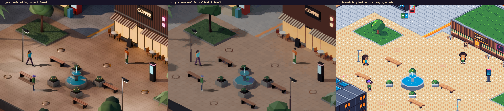

The crops below are 1:1 at the size the game would draw them. Each 96 × 48 px diamond has the same
area as today's 48 px tile (A1's 16 px tiles at 3×). So a crop shows as much of the town as a
22 × 14-tile window does now. In the comparison above, the pixel art is at an exact 2× and the
renders are scaled to match.

## 1. Pre-rendered 3D, XCOM 2 level

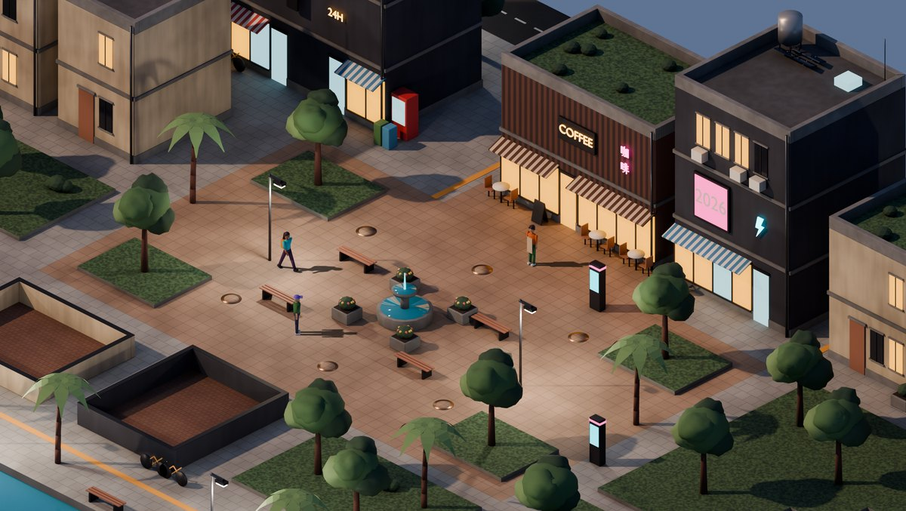
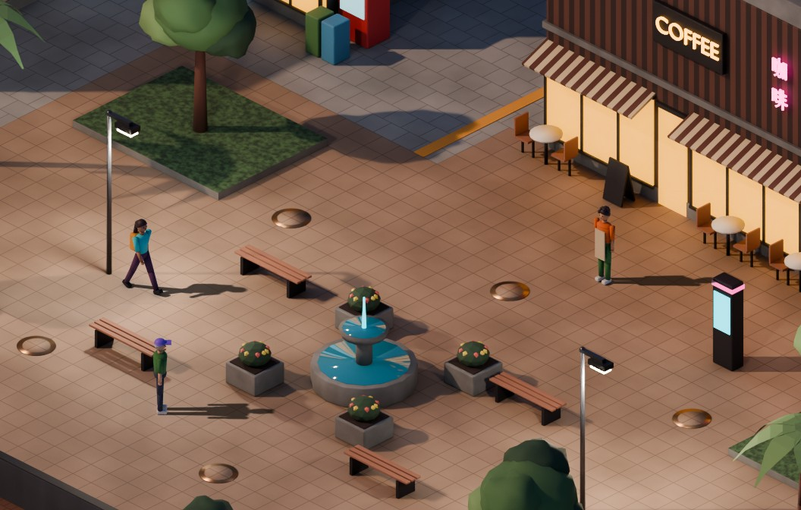

`render3d.py` builds the whole village in Blender from the map. Ground comes from the `ground`
layer, and grass beds are raised behind a kerb. Each block of `buildings` tiles becomes a building:
the footprint is the block, there's one 3 m storey per facade row, the facade tiles become windows,
doors and shopfronts, and the wall decor becomes awnings, neon, the street screen and AC units.
Props come from `decor`. The script adds parapets, storey bands, window AC units, water tanks,
grime and bump. Cycles on Metal renders it with 48 samples and denoising, AO in the shaders and the
AgX view, at dusk with emissive neon and lamps. `compose.py` adds the glow and composites the
residents, which are rendered separately as sprites with their shadows, the way the game would draw
them.

Buildings south of the square would hide it, so they're cut away to their walls, as XCOM does.
`--part objects` renders every building whole, and one sprite per prop kind, each on its own. That's
what C1 would draw over a ground layer, and it's where the full-set estimates below get their
numbers.

**Characters** are built from primitives, using `appearance` for build, skin, hair style and
colours, and accessories. Rigid parts are parented to an 11-bone armature, with no skinning. The
walk cycle is procedural: thigh and arm swing, knee bend and a hip drop that keeps the feet on the
ground. The strip is Ingrid in 8 directions × 8 frames:

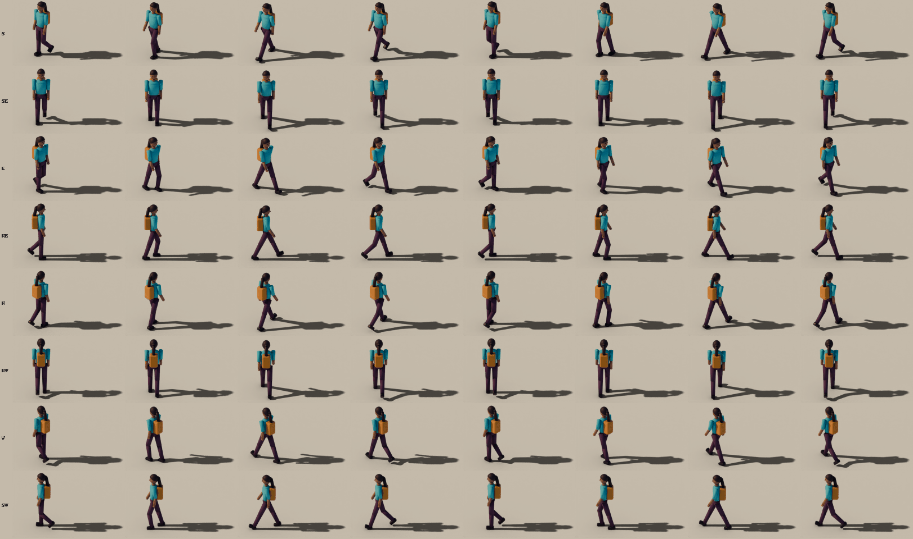


## 1b. Pre-rendered 3D, Fallout 2 level

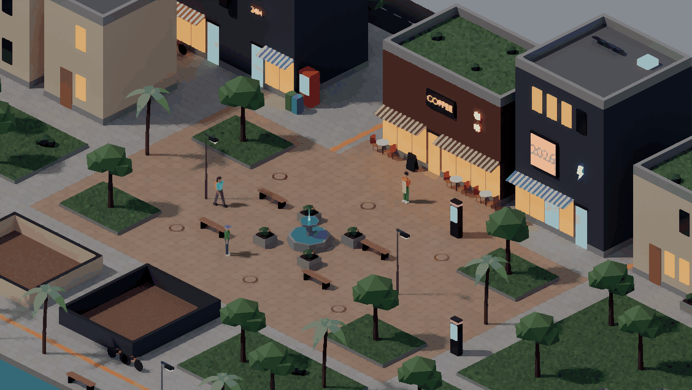
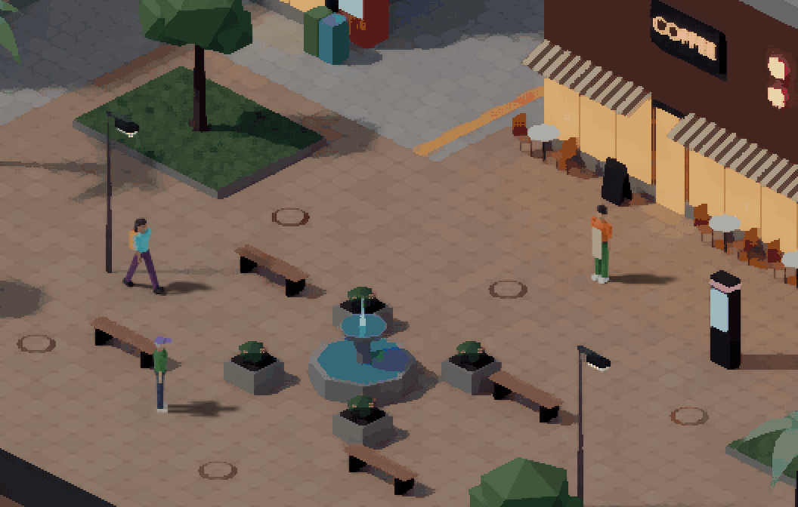

The same script with `--level fallout` turns the detail down:

- 8-sided cylinders instead of 16, and simpler trees.
- No bevels, window frames, AC units, grime or bump.
- A 7-bone rig with no knees or elbows.
- 4 directions × 6 frames. Without knees the pose depends on `sin(phase)` alone, so frames sit a
  quarter step off the cycle's turning points to keep all six distinct.
- Half the resolution: 48 px tiles, drawn at 2×.
- 20 samples, a softer and higher sun, and daylight.

`compose.py` then applies a Kuwahara filter for the painterly look and reduces everything to one
256-colour palette: A1's 32 colours, 160 from the scenery and 64 kept for the residents. Without
that reserve, the median cut gives the scenery all the colours and the residents' clothes go grey.
The palette is modern Shenzhen, not post-apocalyptic. Both levels can use either lighting, since it's
two numbers in `LEVELS`.

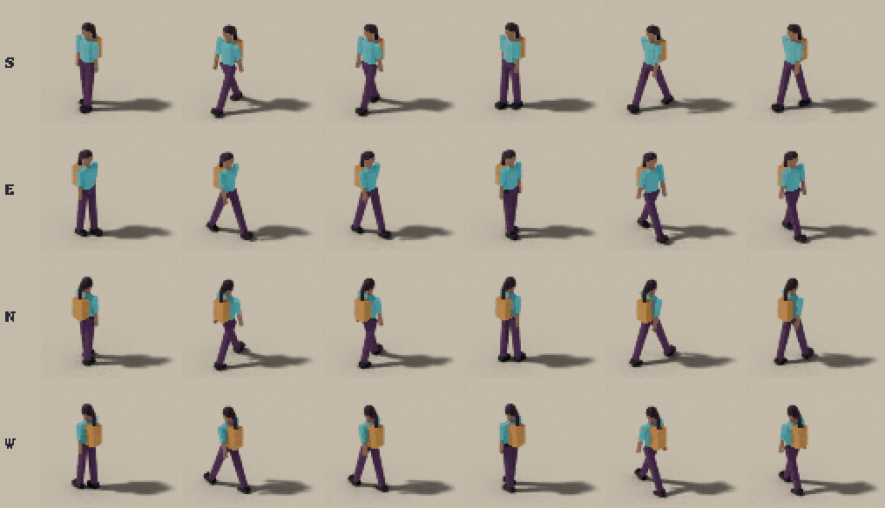
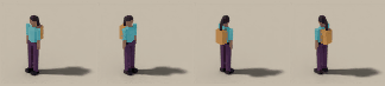

## 2. Isometric pixel art in code

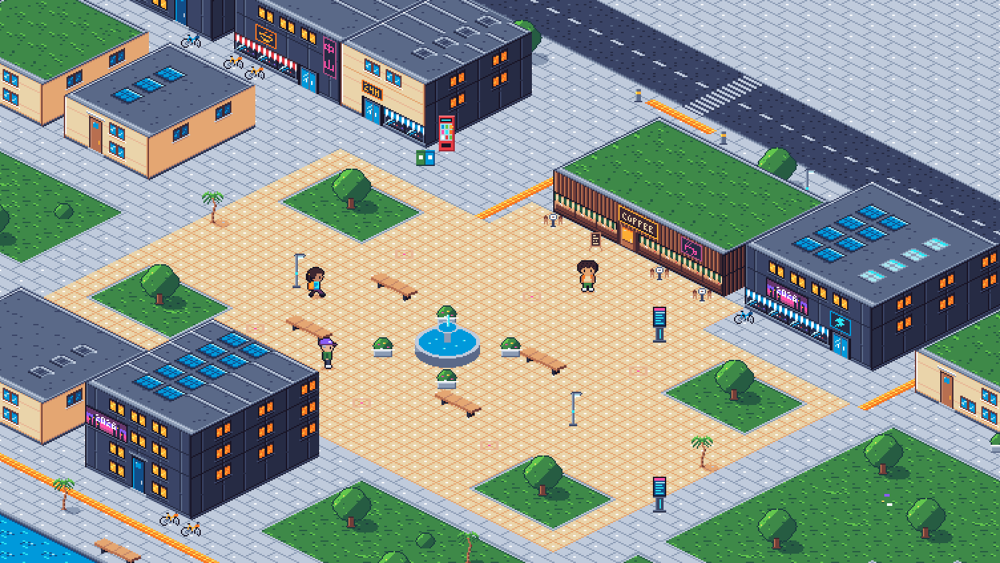
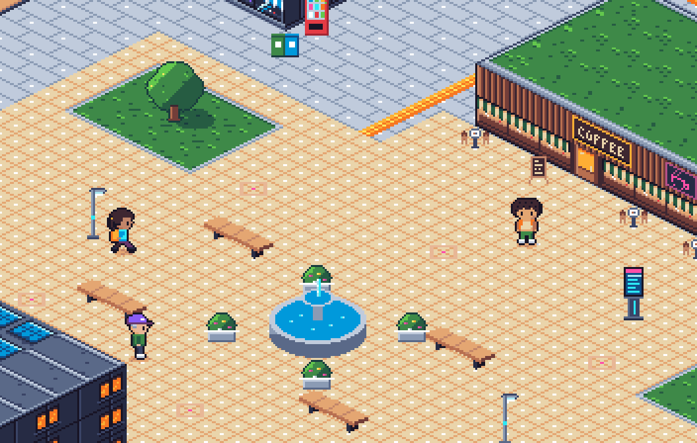

`pixel_iso.py` extends A1 rather than redrawing it, and every pixel is one of A1's 32 colours (the
script checks). It runs in about a second.

- **Ground and roofs** are A1's top-down tiles, resampled onto 32 × 16 diamonds. Horizontal and
  vertical lines in a tile become 2:1 iso lines, so A1's pavers, grass edges and roof slices carry
  over cleanly.
- **Facades** are A1's facade and wall-decor tiles, laid out as in the map and sheared onto the
  building's south face. East faces repeat the wall and window tiles one shade darker.
- **Upright props** (trees, palms, lamps, terminals, the vending machine, bins, planters, café
  tables) are A1's sprites as they are. **Benches and the fountain**, which A1 draws from above,
  are redrawn in iso.
- **Residents** are A1's sprites as they are.

What doesn't carry over:

- **Directions.** A1 has four views: down, up, left and right. In iso those match the grid's
  diagonal moves, which are screen-vertical and screen-horizontal. Moves along the grid axes are
  screen diagonals, and they need new 3/4 views: front-3/4 and back-3/4, mirrored for the other two.
  That means new art for each of the 8 hair styles and 8 accessories. Until then, those moves snap
  to the nearest of the four views, as Ingrid does here.
- **Building height.** A1 gives each storey one 16 px row, so buildings come out low and read as
  bungalows. The upside is that they hide very little of the square.

## 3. Image-model assisted: not generated

**FLUX.1-schnell is gated.** Its weights are Apache-2.0, but `black-forest-labs/FLUX.1-schnell`
only serves them to a logged-in Hugging Face account that has accepted the repo's access
conditions. mflux 0.22.0, installed in its own venv under `~/.cache/simile-style-study/`, stopped
at the first weight file:

```
huggingface_hub.errors.GatedRepoError: 401 Client Error.
Access to model black-forest-labs/FLUX.1-schnell is restricted. You must have access to it and be
authenticated to access it. Please log in.
```

This run's rules were not to log in, not to accept a licence and not to use re-uploads, so
**there are no approach 3 images.** `flux.sh` is the exact attempt. It holds the prompts for a
set piece (the café) and both consistency tests: two plaza tiles that should match, and Ingrid in
two poses with the same seed. It runs as it is once the user accepts the gate on their Hugging Face
account and logs in as usual (`hf auth login`, or `HF_TOKEN` in the environment). The script only
moves the weights, setting `HF_HUB_CACHE` to `~/.cache/simile-style-study/hf/hub`, so the login is
found where it normally lives. The download is 33.7 GB in the diffusers layout mflux
uses.

Two Apache-2.0 models that aren't gated, per the Hugging Face API, and that mflux 0.22 supports:
`Tongyi-MAI/Z-Image-Turbo` (`mflux-generate-z-image-turbo`) and `black-forest-labs/FLUX.2-klein-4B`
(`mflux-generate-flux2`). Either needs the user's go-ahead.

**How bad the consistency would be: expected, not measured tonight.** Text-to-image has no notion
of a 2:1 grid or of tile edges, so two "matching" tiles won't share edges. Cleanup can force them
onto a grid and a palette: `compose.py`'s `shared_palette`/`reduce` and A1's `nearest()` do the
palette, and a perspective warp to the diamond does the grid. Cleanup can't make the content line
up. A character prompted twice, even with the same seed, changes face, clothes and proportions, so
walk frames won't register. The usual fix is to condition the model on renders with ControlNet
(mflux has `mflux-generate-z-image-controlnet` and FLUX ControlNet). That makes approach 3 a
paint-over on top of approach 1's geometry rather than a pipeline of its own.

## Costs

Measured on an M2 Max with Blender 5.2.2. The whole study regenerates in 2.5 min
(`BLENDER=/opt/homebrew/bin/blender ./render.sh`), plus about 60 s the first time Blender compiles
its Metal kernels.

| | 1. XCOM 2 level | 1b. Fallout 2 level | 2. Pixel art | 3. FLUX |
|---|---|---|---|---|
| Mock-up scene | 2256 × 1272 px, 93k triangles, 1,351 objects, **16 s** | 1128 × 636 px, 27k triangles, **2 s** | 752 × 424 px, **1 s** | not run (gated) |
| One resident | ~2k triangles, 11 bones, 0.55 s a frame | ~550 triangles, 7 bones, 0.45 s a frame | A1's `draw_frame`, instant | |
| **Full asset set, machine time** (estimate) | **~10 min**: ground layer ~80 s (4.9× the mock-up's area), 32 object sprites 49 s (measured), 11 characters × 72 frames ~7 min | **~3 min**: ground ~10 s, objects 21 s (measured), 11 × 28 frames ~2.3 min | **~5 s** | 33.7 GB download, then each asset is prompt, pick and clean up; not measured |
| **Building the pipeline** (estimate) | 3–5 agent-days from this study, plus art-direction rounds; +2–4 days for realistic rather than toy-like people (a skinned body mesh, e.g. MPFB) | 2–4 agent-days: the same code with the detail dial down, so the saving is machine time and size, not authoring | 1–2 agent-days: bake an iso tileset, redraw A1's top-down props, draw 3/4 views for every hair style and accessory | unknown, and animation still needs 1 or 2 underneath |
| **How characters animate** | Rig + procedural cycles rendered to frames; 8 directions × (8 walk + 1 idle). A new animation (talk, sit) is a pose function: +64 frames, +35 s, ~+0.7 MB a character | Same, 4 directions × (6 + 1); 8 directions doubles it | A1's 3-frame yoyo in 4 views; the other 4 directions need 3/4 views | No frame-to-frame consistency without ControlNet over 1's renders |
| **New resident** | Automatic from `appearance`: ~40 s of rendering | Automatic: ~13 s | Automatic (A1) | A prompt per resident, plus a human pick; no guarantee they look the same twice |
| **New building** | Automatic from its tiles in the map; re-render it and the ground | Same | Automatic from A1's tiles | Generate, then fit it to the footprint by hand |
| **Size on disk, full set** (estimate) | Ground ~14 MP: ~3 MB as JPEG/WebP, ~18 MB as PNG. Object sprites: 0.6 MB trimmed at 256 colours, 0.35 MB as WebP (9.6 MB as raw PNG). Characters ~0.8 MB each as trimmed 256-colour atlases (2 MB raw). **~13 MB** (vs 0.7 MB for all of `content/art` today) | Ground ~3.5 MP: ~2 MB at 256 colours; object sprites 0.15 MB; characters ~0.1 MB each. **~3 MB** | **~0.1 MB** | n/a |
| Runtime | 2D sprites in Phaser, no extra GPU work beyond texture memory: ~60 MB for the XCOM ground layer (in ≤ 4096 px chunks), plus the sprite atlases | | | |

The estimates cover what C1 would need, not one baked background. That's a ground layer for the
whole 64 × 42 map, a sprite for each of the 16 buildings and one per prop kind (anything a resident
can walk behind), and 11 characters (10 residents and the player).

- **Object sprites** are measured with `--part objects`.
- **The ground layer** scales the mock-up's background render to the whole map. In production,
  the objects would be hidden from its camera (Cycles' `visible_camera`) so that their shadows still
  land on it. That's an untested assumption about its cost.
- **Identical props share one sprite.** Every lamp is the same lamp, for example. Machine time is per frame, not per pixel: a 211 × 139 frame takes 0.55 s
and a 91 × 70 frame 0.45 s, mostly Blender's per-render overhead.

## Recommendation

**Approach 1, pre-rendered 3D, at the XCOM 2 level.** It's the only option that's a real step up
from the 80s look, and it's all code: deterministic, re-rendered in minutes, with residents and
buildings coming straight from `appearance` and the map, as they do today.

Keep `--level fallout` as a dial rather than a separate choice. It's the same pipeline with less
detail, so it saves download size and render time, not authoring. Use it if the web build's size
turns out to matter. Approach 2 is by far the cheapest and works better than expected, but it keeps
the retro feel the user wants to move on from. Approach 3 is blocked tonight, and even ungated it
would be a paint-over on top of approach 1.

**Needs a human's eye:**

- The characters are built from primitives and look toy-like (Playmobil) rather than
  XCOM-realistic. Whether that's charming or a placeholder is a taste call, and realism is the
  +2–4 days above.
- Baked light fixes the time of day. The XCOM mock-up is at dusk and the Fallout one in daylight,
  and either level can use either. [Four times of day](#four-times-of-day-122) renders a set for
  each.
- Only the three residents shown were reviewed. Every `appearance` option is modelled, but bob,
  long, bun, beanie, scarf, glasses, sunglasses and headphones haven't been looked at in a render.
- The camera looks from the south-east. The alternative is the south-west, which would show west
  faces instead of east ones.
- In approach 2, decide whether low A1-height buildings are acceptable.

## Four times of day (#122)

The XCOM-level square rendered four times, so the world doesn't feel like a casino. Each set has its
own sun (the moon at night), sky and ambient light, so the shadows move. Lamps are off by day, and
neon, lit windows and screens drop to 12%, 10% and 60%. In the evening they're at 70–90%, and at
night at full strength. The residents here are drawn as (b) with the light map, described below.

| Night | Morning |
|---|---|
| 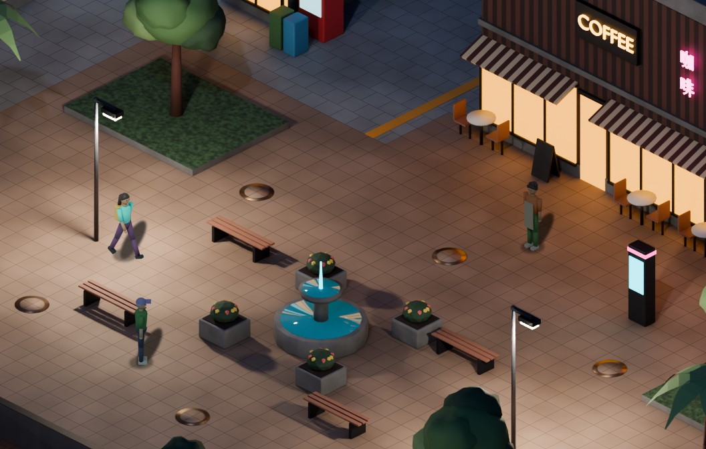 | 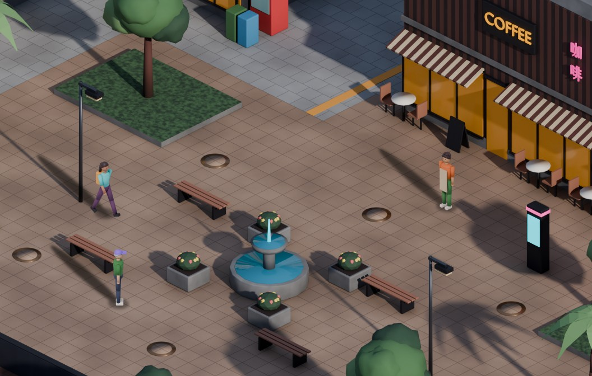 |
| **Afternoon** | **Evening** |
| 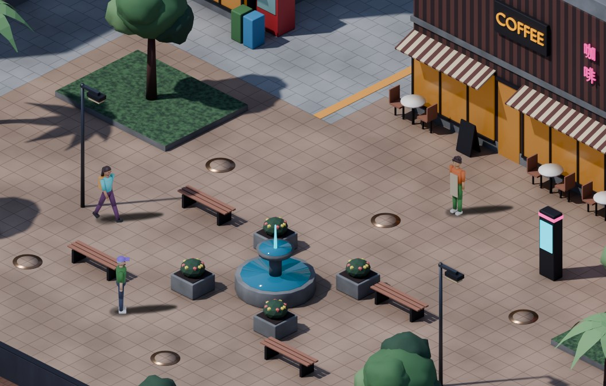 | 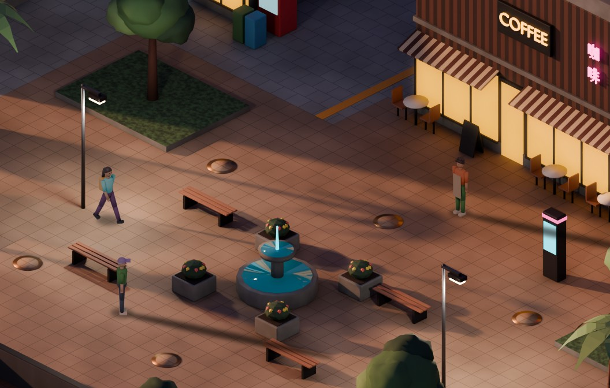 |

The whole scene at half size: [night](lighting/1-night.jpg), [morning](lighting/2-morning.jpg),
[afternoon](lighting/3-afternoon.jpg), [evening](lighting/4-evening.jpg).

**Hour spans.** `scene.TIMES` has the spans and the sun's positions:

| Set | Sim hours | Sun | Shadows on screen | Why these hours |
|---|---|---|---|---|
| Night | 21:00–05:00 | Moon from the SSE (150°), 50° up | Short, up | The first residents go to bed at 21:00, and nobody is out from 00:00 to 05:00 |
| Morning | 05:00–11:00 | ESE (105°), 26° | Long, up-left | Wake times run 05:30–09:00, then the café's morning peak |
| Afternoon | 11:00–17:00 | SW (215°), 52° | Short, right | Lunch at the noodle bar, then the square's and the café's busiest hours |
| Evening | 17:00–21:00 | WSW (248°), 16° | Long, right and a little down | Dinner. The street is busiest from 18:00 to 20:00 |

In `simile behaviour simulate --hours 24 --seed 0`, of the time residents spend out of home, 25% is
in the morning, 40% in the afternoon, 26% in the evening and 9% at night. So residents are out in
daylight two thirds of the time, and under the neon look a third of it.

The iso view squashes the ground, so afternoon and evening shadows both point right on screen. What
mostly sets them apart is length: 1.4 m against 6.3 m.

**Crossfade: 60 sim minutes, centred on each boundary**, so 04:30–05:30, 10:30–11:30 and so on, with
smoothstep weights. `scene.blend(hour)` gives the sets to draw and their weights. The frame below
blends the two renders pixel by pixel: outgoing × (1 − weight) + incoming × weight. To get that in
Phaser, draw the sets in pairs: the incoming ground directly above the outgoing ground, and each
object's incoming sprite directly above its outgoing one at the same depth, at alpha = weight. Both
sprites of a pair have the same silhouette, so nothing behind shows through. Don't put the
incoming set in its own Layer or Container with alpha = weight. Phaser 3 applies that alpha to each
child separately, so halfway through about a quarter of the ground and the objects behind would
show through the incoming objects. Mid-fade, every shadow shows twice at half strength. Smoothstep
gets through the 25–75% stretch in 35% of the fade, rather than half of it. At 1× a fade lasts an
hour of real time. At 60× it lasts a minute, and the doubled shadows are obvious for about 20 s.

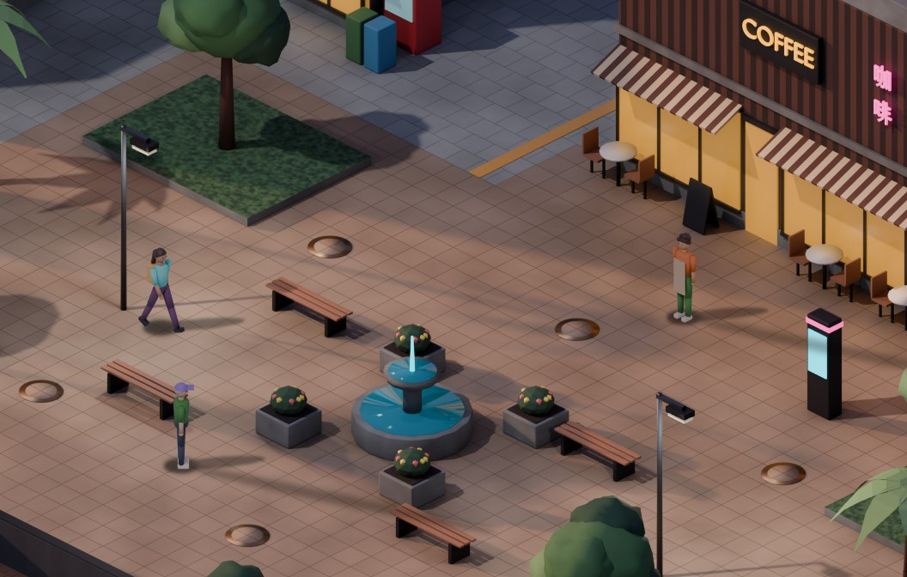

([Whole scene](lighting/5-crossfade-afternoon-evening.jpg).)

**Characters under the light.** The same three residents, one row per set:

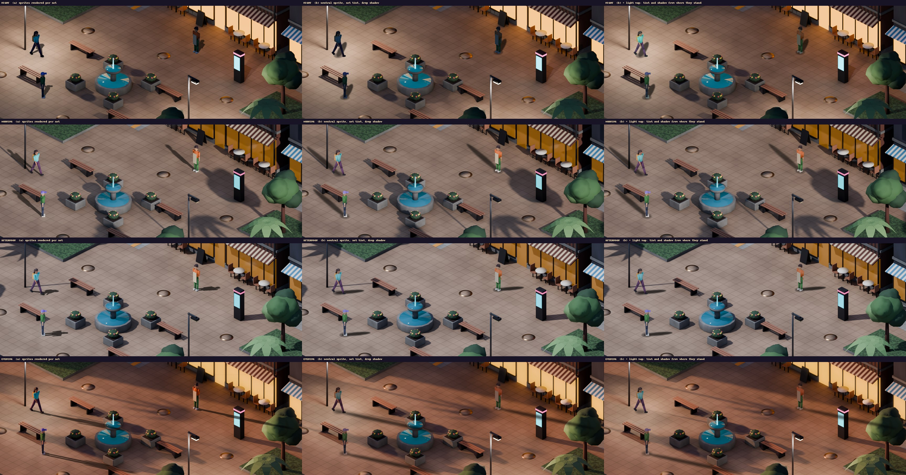

- **(a) Sprites rendered per set.** Each set's sun and sky, with the shadow baked into each frame
  by a shadow catcher. The frame grows to hold the shadow: 483 × 239 px in the evening, against
  87 × 155 px without one.
- **(b) One neutral sprite set, a tint and a drop shadow.** The neutral render has a soft white
  light and no shadow. Each set has a tint and a shadow strength, measured once by comparing a probe
  frame with the neutral render:

  | | Night | Morning | Afternoon | Evening |
  |---|---|---|---|---|
  | Tint (RGB) | 0.17, 0.25, 0.36 | 0.98, 0.96, 0.95 | 0.85, 0.88, 0.92 | 0.62, 0.49, 0.46 |
  | Shadow alpha | 0.64 | 0.57 | 0.70 | 0.59 |

  The drop shadow is a soft ellipse on the ground, from the feet away from the sun, with length
  height ÷ tan(elevation). In Phaser that's an image rotated to the sun, inside a container
  scaled to half height for the iso ground plane. During a fade each resident has two, weighted
  like the layers.
- **(b) with the light map.** For each set, a top-down render of the direct light on the ground
  from the sun, the sky, and the lamps and lit signs, at 8 px a tile, in about 3 s. A resident's
  tint is scaled by the light where they stand compared with the open square, and their drop shadow
  fades out where the sun doesn't reach. So at night Ingrid under the lamp and Odalys by the café
  window are lit. In the evening Ingrid, standing in a tree's shadow, loses her own. At runtime it
  would be one small RGBA texture per set: the tint in RGB and the sun in A, sampled at the feet.
  Phaser's `setTint` can't go above 1, so the neutral sprites are lit brighter than any set and a
  tint that would pass 1 is scaled down, keeping its hue.

Neither (a) nor plain (b) can react to where a resident stands. Sprites are rendered once per frame,
not once per place.

**Costs**, measured on the M2 Max, Cycles at 48 samples. "Scenery set" is what C1 needs for one
set. That's the ground layer (the mock-up's render time × 4.9, as in [Costs](#costs)), 32 object
sprites and the light map. Its disk size is the ground as a JPEG plus the object sprites at 256
colours. Characters are Ingrid's walk cycle (8 directions × 8 frames), extrapolated to 11 residents
× 72 frames, with atlases at 256 colours with alpha.

| Set | Mock-up scene | 32 object sprites | Light map | Scenery set | Scenery on disk | One walk frame | 11 residents | Atlas per resident |
|---|--:|--:|--:|--:|--:|--:|--:|--:|
| Night | 16.5 s | 48.5 s | 3.6 s | 2.2 min | 2.2 MB | 0.54 s at 114 × 155 px | 7.2 min | 0.07 MB |
| Morning | 16.3 s | 46.6 s | 3.5 s | 2.2 min | 2.9 MB | 0.59 s at 214 × 157 px | 7.8 min | 0.13 MB |
| Afternoon | 14.3 s | 45.9 s | 3.2 s | 2.0 min | 2.9 MB | 0.58 s at 182 × 155 px | 7.7 min | 0.11 MB |
| Evening | 16.4 s | 47.7 s | 3.2 s | 2.2 min | 2.5 MB | 0.85 s at 483 × 239 px | 11.2 min | 0.15 MB |
| Neutral, once | | | | | | 0.50 s at 87 × 155 px | 6.5 min | 0.09 MB |

- **(a), all four sets: 42 min and 15.5 MB.** 3,168 character frames.
- **(b), all four sets: 15 min and 11.5 MB.** 792 character frames, and each new animation or
  resident is rendered once rather than four times.

#116 estimated 40 min and 52 MB. The time holds for (a). The disk is lower because a resident's
atlas measures 0.07–0.15 MB, not the 0.8 MB #106 estimated, so the scenery is most of it.

**Recommendation: (b) with the light map.**

- Its shadows point the same way and are the same length as (a)'s in every set (compare the
  columns).
- It's the only one that lights a resident by where they stand. (a)'s shadows are baked into every
  frame, so a resident in a building's shadow still casts one.
- Fades are smooth: the tint and shadows follow the fade weight. With (a), every resident is two
  sprites through every fade.
- It takes about a third of the machine time.

What it gives up: the shading on the body doesn't turn with the sun. In the evening, (a) has a warm
sunlit side and a cooler shaded one, while (b) is evenly warm. At 1:1 the difference is small (the
evening row). If it matters later, a normal-mapped sprite under Phaser's Light2D brings it back,
still from one render.

**Needs a human's eye:**

- The look of each set: whether the evening should be more golden than this dusky orange-pink, how
  bright the night's lamp pools are (exposure +0.5), and whether neon at 12% in daylight is too
  much or too little.
- The doubled shadows mid-fade, and whether 60 minutes is the right length.
- The evening sun at 16° casts 6 m shadows (5.7 tiles), which reads as evening but could get busy
  with ten residents.
- Whether residents lit by a lamp at night (near-neutral tint) read as lamp-lit or as daylight.
- Whether (b)'s fixed body shading is acceptable.

The same 45% of windows are lit in every set; only their brightness changes. Glow is a post effect
at 100% at night, 85% in the evening and 25% by day.

## What a switch would touch

The simulation stays on its square grid. Only the projection changes. Screen position is
`((x − y) · w/2, (x + y) · h/2)` for a w × h diamond.

- **W1 map.** For approach 1, `village.tmj` can stay orthogonal: `render3d.py` reads it directly
  and the client draws the renders instead of tile layers. Locations, collisions and entries keep
  their tile coordinates. Converting to a Tiled isometric map is only needed for approach 2's
  tileset route.
- **C1 rendering.**
  - Draw the iso projection, with depth sorting by the screen y of each sprite's feet.
  - Anything that can hide a resident (buildings, trees, lamps, terminals, benches) has to be its
    own sprite rather than part of one baked background. The renderer then outputs a ground layer
    plus a sprite per object, with the same camera and shadows baked into the ground.
  - Tall buildings south of the player need a cutaway or fade, as the mock-up does.
  - The camera bounds follow the diamond.
  - Arrow keys map to screen directions. Screen-up is grid north-west, a diagonal step, which
    8-direction pathfinding already allows.
  - Player collision stays in tiles: convert the input, not the grid.
- **Picking.** Clicking a resident (the debug overlay, and #101's targeting) needs iso hit-testing:
  test sprite bounds or alpha, front to back. Residents stand about 1.5 tiles tall, so a click lands
  above their tile.
- **C2 bubbles and C3 audio.** Positions come from the projection: a bubble sits at the feet's
  screen position minus the sprite's height. Earshot stays in tiles.
- **A1** is replaced by this pipeline, and sprites still come from each resident's `appearance`.
  Blender isn't a Python dependency, so the generator runs it as a subprocess. CI can't render, so
  the renders are committed under `content/` as today. Tests check metadata and atlases, and the
  renders get an `mlx`-style local-only marker.
- **Server, pathfinding and protocol:** unchanged.

## Files

| | |
|---|---|
| `scene.py` | The shared scene: reads the map, the residents and A1's palette; the view, crop and resident placements; the times of day and `blend(hour)` |
| `render3d.py` | Approaches 1 and 1b: `blender -b -P render3d.py -- --level xcom\|fallout --part scene\|sprites\|walk\|objects\|lightmap\|all`, plus `--time night\|morning\|afternoon\|evening\|neutral` for a lighting set |
| `character.py` | The residents from primitives on the armature, and their walk cycle. A body mesh can replace it |
| `compose.py` | Composites the residents, adds glow, the painterly filter and the palette, and writes `images/`. `compose.py lighting costs` writes `lighting/` and prints the costs |
| `pixel_iso.py` | Approach 2, run from `server/` so it can import A1 |
| `flux.sh` | Approach 3, as attempted |
| `render.sh` | Everything, in order. `./render.sh lighting` does the four times of day in about 9 min |

Renders and scratch files go to `out/`, which is gitignored. `make test` and `make lint` don't reach
this folder: ruff runs in `server/` and eslint in `client/`. The scripts pass the server's ruff
config anyway.
